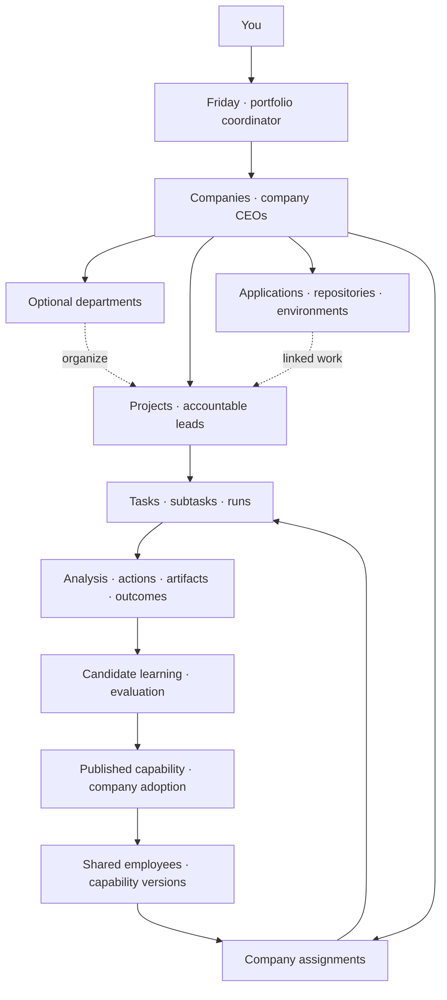

# Agent OS operating model and delivery plan

Status: Consolidated target design for implementation. This plan does not certify that the capabilities below are already implemented.

Agent OS operates a portfolio of companies through Friday, a shared workforce and a complete record of operational work. Provider harnesses supply execution capabilities. Agent OS retains company authority, work ownership, execution evidence, analysis, decisions and evaluated learning throughout each workflow.

This is the current Agent OS product and delivery plan. It supersedes the single-company portfolio and provider-selection assumptions in the [earlier implementation plan](2026-10-25-agentos-platform.md). That document remains the historical implementation and qualification record. Existing Paperclip execution, authorization and persistence contracts remain in force until an explicitly scoped implementation extends them.

## Product decisions

- Agent OS is the platform. Customer companies are separate ventures; internal platform maintenance is identified separately from the customer application portfolio.
- Friday sees the user's authorized portfolio. Each company has a CEO limited to that company. Friday delegates ongoing operations to company and pipeline leads.
- One persistent employee identity can work across companies. Each company assignment has separate authority, context, management, capacity and adopted capability versions.
- CEOs can hire, reassign and retire assignments within their approved authority and resource limits. Retirement affects only that company's assignment. Every staffing and refinement action has an audit record.
- Capabilities improve centrally through recorded evidence and evaluation. Companies choose whether to adopt each new version. Candidate improvements do not silently alter other companies' operating profiles.
- Friday is the main light-themed, voice-first interface. Typing is collapsed until requested. Decisions and blockers surface automatically. Native inspection and manual controls remain accessible.
- Friday can change the Agent OS platform only in response to an explicit user request and within the resulting authorized scope. A capability gap alone does not authorize a core platform change.
- Existing, in-flight repositories and new ventures are both first-class onboarding paths. Building Agent OS does not depend on the user first supplying a customer application.
- Operational visibility is an execution requirement. Capture work, analysis, actions, delegation and capability changes as they happen. Periodic agent-written reports alone do not satisfy it.
- Harnesses are selected by demonstrated compatibility and task quality. No particular hosted agent product is the architectural dependency.
- Preserve subscription-backed execution by default. The user currently has Personal Pro available. Enterprise-only features are not assumed; API billing, bundled API credits and paid voice services require a separate explicit choice. No automatic paid fallback.

## Organization and ownership

Departments are optional stable functions such as Engineering, Product, Marketing, Sales and Operations. Projects are bounded outcomes or ongoing initiatives; they may cross departments and have one accountable lead. Start with a primary department and participating teams where useful, without requiring a department for every project. Tasks remain single-assignee native issues with explicit delegation and dependencies.

Applications are durable assets with repositories, environments and resource bindings. Multiple projects can develop, market or operate the same application. Companies and marketing-only projects do not require an application. Keep native provider connections distinct from the applications being operated.

| Record | Responsibility | Native foundation or extension |
| --- | --- | --- |
| Portfolio and membership | Authorized collection of companies and Friday's delegated access | Add a narrow portfolio layer; retain company and private-resource ACL checks |
| Company | Venture, CEO, objectives, operating limits and resource ownership | Existing company records and operating policy |
| Employee identity | Persistent specialist identity, central capabilities and evaluation history | New shared identity; contains no unrestricted company transcript or credentials |
| Company assignment | Employee's manager, role, access, context, adopted versions and lifecycle in a company | New engagement mapped to company-scoped native agent/runtime bindings |
| Department | Optional organizational grouping and reporting | Add grouping without another task or permission engine |
| Project, application and task | Outcomes, durable products and executable work | Extend existing native projects, application registry and issues |
| Run and delegated run | Execution ownership, parentage, attempt and runtime configuration | Existing runner and run records; extend correlation and coverage contracts |
| Decision | Action needing a human choice, with evidence and exact proposed scope | Portfolio projection over native approvals, interactions and task documents |
| Capability version and adoption | Instructions, skills, dependencies, evaluations and selected company version | Reuse catalogs and revision history; add shared publication/adoption records |
| Learning candidate | Evidence, proposed method, tests, reviewer and disposition | Native tasks/documents/artifacts plus explicit learning/version references |

The current database makes native agents company-scoped. Preserve that execution boundary. A shared employee identity links its company assignments rather than removing `companyId` checks. Friday's portfolio queries and delegated writes must use explicit user-authorized grants, attribute the initiating user and validate each target company. Ordinary agent keys do not become portfolio-wide keys.

Cross-company employee chat aggregates only what the current speaker may access. The company CEO cannot use a shared employee to discover another company's work. The owner's portfolio view can inspect all authorized assignments. Same employee identity does not require an unrestricted shared browser, credential store or provider memory across companies.

## Friday and the workspace

The primary navigation is Friday, Companies, Decisions and Workforce. Search, audit and settings remain available as utilities. Company detail contains its overview, projects, applications, workforce, routines, artifacts and knowledge; these do not all need permanent global sidebar entries.

Friday has three coordinated states:

1. Home: a prominent original pulsing orb, a minimal typing control, and concise decisions/blockers that need the user.
2. Working view: Friday docks at the bottom right while a native company, project, task, decision or workforce view occupies the canvas. Voice and conversation survive navigation.
3. Generated canvas: Friday renders a scoped table, chart, report or other requested display. Prefer registered components with typed data. Custom code runs in an isolated preview without direct parent-app or credential access.

Repeated displays become versioned reusable layouts, populated with current authorized data. Saved snapshots retain their source and observation time. Turning a generated display into privileged platform code follows the explicit platform-change process.

Voice supports listening, interruption, speaking, mute, transcript correction and an accessible typing fallback. Voice yes/no resolution binds to an identifiable proposal revision; ambiguous speech or uncertain submission produces a clarification instead of a duplicated action. Existing authorization covers routine substeps without repeated approval questions. Do not infer consent from silence. Test real microphone and audio playback in supported browsers.

The Decisions view aggregates native human requests and genuine blockers across the portfolio, with company/project/task context, evidence, recommendation and effect of the choice. Resolve the source record through its existing permissions and revision checks. Preserve rejection, revocation and superseded proposals. Distinguish decisions needing a choice from operational problems already being handled by agents.

The Workforce view preserves harness, model, instructions, skills, account connection, capacity and spend settings. It also shows each employee's company assignments, active work, conversations, capability versions, evaluation history and retirement/adoption trail. A company-specific runtime binding remains inspectable beneath the shared identity.

## Execution and visibility contract

Every admitted workflow must have a defined observable execution surface. Private model internals are not promised as exported data. The Thinking view contains explicitly published analyses and provider-exposed reasoning, labeled by source; it must not invent or reconstruct a hidden internal transcript. Complete operational coverage includes the actions, delegation, evidence and learning that determine company outcomes.

### Admission and action recording

- Register the company, project, task, employee assignment, parent run, attempt, effective instructions, skills, runtime and allowed resources before execution starts.
- Attach capture before admission. Require children to register and attach before they receive company resources. Disable unobservable delegation paths for workflows that require them to be tracked; do not silently allow an invisible subtree.
- Use native authorized tools and controlled execution environments. Persist an action intent before dispatch, then persist the result or an explicit unknown outcome. Acknowledged writes must have durable receipts.
- Combine provider execution events with gateway receipts and source-system results. Instructions asking an agent to log work supplement runtime evidence; they are not the enforcement boundary.
- Store stable operation identities and source event identities. Handle duplicate, delayed and out-of-order events, reconnect catch-up and interrupted writes. Never re-execute an unknown external effect under a fresh identity to obtain a cleaner record.
- Preserve native single-assignee checkout, leases, authorization, budgets and finalizers. Extend the native run log and receipt owners; do not add a competing scheduler, task engine, vault or approval service.
- Ordinary diagnostic tracing can remain optional. The durable business execution record is mandatory for admitted work and cannot depend on a best-effort metrics exporter.

### Containment and interrupted capture

Company credentials and publishing/deployment capabilities must be available only through paths covered by the workflow's recording contract. Control shell, browser, connector and network access together; an instrumented MCP connection alone cannot observe an agent's separate signed-in browser or arbitrary network calls.

Where supported, connect provider hooks and per-worker streams. Where those leave gaps, route the operation through a controlled tool or execute the supported harness in an environment we can instrument. If the required capture and authority cannot be enforced, that runtime is not qualified for that workflow. Missing events remain a failed qualification, not a lower standard hidden behind a success badge.

If durable capture is unavailable, stop admitting controlled actions and preserve queued work. Inspect and reconcile effects already in flight. An external provider may continue independently; distinguish revocation of Agent OS authority from confirmed remote termination. Do not dispatch overlapping replacement work while the previous result is uncertain.

### Evidence model

| Evidence | Required record |
| --- | --- |
| Analysis | Question, hypothesis, source references, alternatives, rationale, uncertainty and revisions |
| Resource use | Actual read/query/tool action, resource version where available, time and access context |
| Delegation | Parent and child identity, instructions, messages, status, outputs and completion evidence |
| Execution | Requested action, permissions/policy result, start, outcome, errors, retries and receipts |
| Artifact or release | Immutable output reference, revision/digest, producing run, checks and observed destination |
| Learning | Observation, evidence, proposed capability diff, evaluator, result, adoption and rollback |
| Coverage | Last committed event, stream health, gaps, pending reconciliation and stop confirmation |

Label evidence as agent-reported, runtime-observed or independently verified. A successful run is not automatically a successful business outcome. Retain original failures and the subsequent recovery.

Keep references to the exact input and output revisions needed for investigation. Use permission-controlled artifacts or appropriately protected evidence storage for inspectable content; preserve secret redaction and sensitive-data boundaries. The current run log deliberately omits some API bodies, so a hash alone must not be presented as a replayable input. Define evidence retention and recovery alongside the new storage contract.

## Shared learning and workforce cultivation

Maintain three distinct knowledge scopes: company knowledge; an employee's attributable experience; and centrally published reusable capabilities. Generalize methods before sharing them; do not copy another company's confidential facts into a shared skill.

The cultivation lifecycle is:

`Observation → diagnosis → improvement task → candidate revision → evaluation → limited trial → publication → company adoption → outcome monitoring`

Diagnose access failures, unsuitable assignments, weak instructions, tool limitations and model/runtime failures separately. Retiring an assignment is not proof that the employee is incapable. Preserve its evidence and link any successor or reactivated assignment to the improvement that justified it.

Use comparable evaluation cases, independent review and real outcome measurements. Record effective capability and runtime versions, regressions, latency and observed usage. An agent's self-rating cannot publish a capability as proven. The evaluation workload is itself tracked work with task, run and evidence references. Initial cultivation improves instructions, skills, examples, tools and retrieval; it does not claim to train model weights.

Production assignments pin adopted capability versions. Ordinary permitted skill authoring creates candidates without requiring human approval for every edit. Promotion/adoption follows the configured company authority. Configure the native skill policy where needed so an editable shared file cannot silently mutate a pinned operating profile.

Central learning updates must be inspectable and rollbackable. If a provider has opaque autonomous memory that cannot support the required separation or versioning, it cannot serve as the sole authoritative learning store for those assignments.

## Galaxy and combined views

Use one authorized work graph for visual navigation and Friday's retrieval. Zoom from portfolio to company, project, employee, task, run and source evidence. Allow immediate return to wider scope, breadcrumbs, browser history, search, filters, keyboard access and reduced motion.

Provide Structure and Activity modes. Structure shows assignments and permitted resource access. Activity shows actual reads, messages, delegation, tool operations and returned results. Permission to read a dataset is a different edge from an observed read.

Every work node represents a real record. Spirals and clusters organize those nodes; motion represents committed observed events. The Friday presence orb remains a conversation-state indicator and is visually distinct from work evidence. Large graphs aggregate clusters with accurate authorized totals and explicit expansion, not fabricated filler points.

Company and project workspaces offer galaxy, Kanban, activity and combined layouts. Combined mode keeps the selected graph object, task status, published analysis and execution timeline synchronized. Historical inspection reconstructs captured state; it does not rerun external actions.

Paperclip currently hides some agent-created tasks in ordinary lists by default. Agent OS operational views must include relevant automated work and counts by default, with explicit filtering/grouping for noise. Preserve private-resource ACLs and distinguish conversations, routine instances, recovery work and deliverable tasks.

## Operating applications and recurring work

For an existing repository, discover its branches, active changes, issues, PRs, checks, architecture, deployments, incidents and existing commitments. Preserve existing work. Record an adoption baseline and a proposed operating mandate before executing outside the user's existing authorization. Repository registration and maintainer CLI access do not grant runtime agents deployment or business-account permissions.

For a new venture, record the brief, establish the company and CEO, create projects, select a team, plan the first useful release, create a repository through authorized tooling, implement, verify and deploy through configured environments. Company setup can precede repository creation.

Every recurring pipeline has one accountable lead, one scheduling owner, versioned steps, triggers, success measures, resource limits and escalation conditions. Reuse native routines and durable wakeups. A recurring mandate can authorize ordinary iterations; material changes produce Decisions. Empty polling should not consume model turns. Deduplicate events and reconcile unknown publications or deployments before retrying.

Supported operating domains include engineering/release, production reliability, product discovery, feedback/support, marketing and sales. Each domain uses the same work and evidence contract. Marketing may include video generation, publication, feedback and iteration; each external service still needs a qualified connection and authorized action scope.

Friday coordinates cross-company priorities and exceptions. CEOs and pipeline leads own the actual recurring operations. Friday does not need to be continuously generating responses for durable work to continue.

## Runtime and capacity management

Keep provider protocol details inside adapters and their owning services. Shared code consumes normalized domain events plus explicitly declared capabilities. Preserve provider differences instead of claiming every interface supports identical controls.

Qualify a runtime for a concrete execution mode using task admission, live events, child visibility, tools, artifacts, memory changes, interruption, recovery, identity and funding. Authentication or a completed sample response alone is not qualification. Test the supported subscription integration under the actual account; do not build around unavailable enterprise features.

Use a native account-level admission queue across employees and companies. Reserve capacity for interactive Friday and urgent obligations; apply priority and fairness to background work. Multiple employee names do not multiply a subscription's allowance. Persist work during quota waits and use supported reset information. Unknown usage stays unknown.

The architecture must support replaceable harness bindings, but a running session cannot be silently moved to another provider. Record a handoff, transfer authorized context, reconcile outstanding effects and retain provenance. Requalify capability/runtime combinations after material changes.

## Platform evolution and deployment

An explicit request to Friday can create platform engineering work. Friday scopes the change and delegates it to an engineering lead. That team implements on an isolated branch, verifies, reviews, creates the release artifact and deploys under the authorized release policy. All work appears in the internal platform maintenance view.

Keep release and recovery control usable outside the process being replaced. Preserve active obligations, database compatibility, credentials and artifacts during handover. Link request, tasks, commit/PR, checks, migration, deployed version and verification. Demonstrate rollback and backup restoration; a successful build does not certify either.

An agent finding a missing feature may propose it. It cannot authorize itself to change Agent OS permissions, budgets, release policy or core code. Reusing a generated display does not grant platform engineering authority.

Use a persistent authenticated deployment with database, workers, durable artifact storage and encrypted secrets. A frontend-only host is not a replacement for the control plane. Hosting destination, domain and operational credentials can be selected before production deployment; they do not block local foundation work.

## Paperclip capability disposition

Prefer reversible presentation changes first. Preserve native machinery that provides execution correctness and recovery, even when its controls move out of the primary navigation.

| Disposition | Capabilities | Treatment |
| --- | --- | --- |
| Keep as foundation | Companies, project/task ownership, adapters, runner, leases, atomic checkout, durable wakes, routines, permissions, approvals, credentials, budgets, run logs, documents, artifacts, instruction revisions | Retain their existing owners and extend narrowly |
| Adapt into Agent OS | Company dashboard, attention/Decisions, agents/skills/chat, org structure, portfolio/application views, audit/activity, search | Present through Friday and company workspaces with portfolio-aware authorized projections |
| Keep in administration | Connections, harness/model settings, spend/quota controls, environments, import/export, recovery and diagnostics | Available through settings and Friday; remove clutter from everyday navigation |
| Hide or disable by default | Duplicate dashboard/inbox entry points, separate commentary/timeline entry points, standalone goals navigation, Conference Room, unused status cards and plugin launchers | Retain compatible routes and data where used; consolidate presentation and stop unused triggers only through native owners |
| Archive after dependency review | Unused experiments, alternate onboarding/presentation paths, unselected adapters/plugins and obsolete custom demo code | Index first; preserve tagged source, schemas/data compatibility, dependencies and restoration recipe |
| Remove only after replacement proof | Duplicated custom orchestration, dead code and superseded components with no live consumers | Verify callers, data, jobs, tests and rollback before removal |

Keep native case/handoff/workflow internals where existing work uses them; a hidden Cases page is not permission to delete its records or workflow support. Preserve objectives in company/project context even if Goals disappears from the sidebar. Hide New Chat in the Friday experience while retaining persistent individual employee conversations.

Create a capability inventory before deletion. For each item record purpose, current use, code/routes, API and data dependencies, background triggers, owner, lifecycle state, reason, replacement, last qualified revision and restore steps. Reference the existing feature/access maps. Archive source in Git with a tag and a restore procedure; do not move imports into an archive folder and leave a broken build. Avoid dropping database tables merely because a screen is hidden.

Restoration requires dependency and schema compatibility checks, migration review if needed, current tests and requalification. Friday may discover an archived capability through the inventory and restore it only under an explicit user request covering that platform change.

## Current baseline and gaps

The fork already contains company-scoped application/project work, Friday conversation and voice controls, a real-record galaxy and combined views, native attention, individual agent chat, skills/catalog installation, routines, artifacts and audit surfaces. Existing run-log and external-runner contracts provide durable identities and receipts to extend. The earlier plan records implementation checks and a successful Friday subscription-backed read/display run.

The following remain target work: portfolio authority above companies; shared employee identity and engagements; company CEO lifecycle and assignment retirement; complete controlled execution capture and child tracking; evaluated central learning with opt-in adoption; portfolio Decisions; the consistent docked Friday shell; comprehensive resource/activity graph; account-wide capacity admission; qualified cross-functional production loops; and verified platform release/recovery.

Existing UI and tests do not certify those target capabilities. Browser voice/visual acceptance, real specialist delegation and external provider workflows retain their recorded qualification gaps. Preserve earlier failures and superseded checkpoint claims as history; attach new evidence to the exact revision being qualified.

## Delivery sequence

| Phase | Concrete delivery | Required exit evidence |
| --- | --- | --- |
| 0 Foundation and inventory | Tag the current baseline; snapshot runtime data; inventory capabilities, dependencies and active triggers; map existing source owners; establish the observable-action contract | Existing startup/read paths still work; archive candidates and restore paths are identified; no active work or data is deleted |
| 1 Portfolio and workforce | Portfolio membership, company CEO scope, optional departments, shared employee identities, engagements and capability references; migration from current company agents | Two companies share one employee identity; private work remains isolated; local retirement leaves the other assignment working; existing task/history IDs survive |
| 2 Recorded execution | Extend native admission, events, tool receipts, delegation registration, protected evidence and capture-gap handling; instrument one compatible subscription runtime | Live task and child work can be reconstructed; disconnect/restart/duplicate/unknown-outcome tests pass; controlled effects cannot bypass durable recording |
| 3 Friday and Decisions | Persistent voice/typing shell, docked orb, native navigation, scoped generated canvas, automatic portfolio decisions/blockers and direct employee chat | User creates/navigates work and resolves a specific decision by voice or text; conversation survives navigation; cross-company visibility obeys grants |
| 4 Cultivation | Learning candidates, evaluation work, capability publication, company adoption, assignment refinement and rollback | Failure leads to a tested improvement; one company adopts while another stays pinned; evaluation and adoption are fully inspectable |
| 5 Company operations | Existing/new application onboarding, project planning, leads, routine ownership, capacity queue and one full recurring workflow | Existing work is preserved; new work reaches a verified output; background operations survive UI closure/restart; quota waits and stop/resume work without duplication |
| 6 Full work visualization | Graph resource/action coverage, company/project/agent zoom, synchronized Kanban/activity/analysis and historical inspection | Nodes/edges reconcile with underlying records; automated work counts are complete for the authorized scope; live and historical states remain distinct |
| 7 Integrations and platform engineering | Qualify required GitHub/cloud/business tools; user-requested feature development through review and independent release/recovery | A staged application change and an explicitly requested Agent OS change have commit, verification, release and rollback evidence |
| 8 Simplification and production qualification | Consolidate navigation; disable/archive unused capabilities; authenticated persistent deployment, backups and operational monitoring | Archive/restore exercise, database restore, isolation, browser/audio, recurring workflow and failure-recovery journeys pass on the release candidate |

Add a minimal task/analysis/timeline inspector in Phase 2 so visibility is usable before the polished galaxy. Keep the existing Friday interface available throughout migration. Validate each phase against stable source revisions and existing consumers before proceeding to dependent work; use realistic synthetic fixtures first, then an explicitly scoped live workflow.

### First complete operating demonstration

Use two synthetic companies with one shared employee and separate assignments. An agent records its investigation and rationale, creates a child assignment, encounters a controlled failure, recovers, produces an artifact and obtains independent verification. The failure motivates a learning candidate; an evaluator checks it; one company adopts the new version while the other keeps the old version. Retire only one company's assignment. Friday displays the live chain, the decision and the complete retained history.

Interrupt event delivery during the demonstration, restart the worker, repeat an input event, exhaust configured capacity and attempt an unauthorized cross-company read. Verify preservation of evidence, no duplicate external action, no visibility leakage and accurate stopped/unknown states. Use a controlled test destination for effects; provider production qualification is a separate phase.

### Final release acceptance

- The user can operate companies through Friday, with native manual recovery still available.
- Every admitted company action and delegated work item has attributable execution evidence; capture failure prevents further controlled actions.
- Operational analysis and learning are inspectable during work, versioned and linked to outcomes.
- Company assignments, retirement, capability versions and optional adoption behave independently across companies.
- Decisions resolve exact source records without duplicate effects or unauthorized scope expansion.
- Existing and new applications complete representative workflows; recurring operation survives restart and interruption.
- Real graph and combined views reconcile with the execution record, including automated work and pagination.
- Platform changes require a user request and have independent release, rollback and restoration proof.
- Required repository, migration, authorization, UI and live integration checks pass for the release revision. Partial or synthetic evidence is labeled by its actual scope.

## Decisions deferred until their implementation stage

No additional product clarification is required to start the foundation work. Use optional departments, one owner-controlled portfolio, preserved native history and reversible UI simplification as the initial defaults.

Before the relevant integration or release, obtain the actual provider accounts, deployment destination, company operating limits, authorized publication/deployment scopes and retention needs. Select harnesses after capability experiments. Do not reinterpret the existing subscription preference as permission for paid API fallback or assume enterprise account access.

Implementation is performed directly in this repository. The eventual Friday platform-engineering workflow is a product capability to prove, not a prerequisite for building Agent OS here.

## Implementation checkpoint — 26 October 2026

The foundation is implemented directly in the fork. The [capability inventory](2026-10-25-agentos-capability-inventory.md)
records the baseline, local backup, retained functionality and restore procedure.
Additive migrations introduce owner portfolios, company links, shared employees
and company assignments. Native authorization, lifecycle, audit and subscriptions
retain their existing owners. `/workforce` and Friday's `panel=workforce` canvas
provide creation, linking, assignment and company-scoped retirement.

The local instance now has an Agent OS portfolio and six shared specialists bound
to their existing agents. The existing company was renamed Platform Operations;
its ID and project/agent records are unchanged. Friday remains the existing
coordinator, separate from the shared specialist pool. Existing error state is
preserved. No provider workflow or hiring/training quality is inferred from
registering an identity.

Repository-wide typecheck and production build passed. Focused workforce,
OpenAPI, Friday navigation, UI and activity-format checks passed. The broad test
suite is being run separately; the final result belongs in the delivery record.
The local server restarted with both migrations applied, no pending migration
and no interrupted active run. Real browser/audio acceptance remains blocked by
the host browser tool connection, not certified by HTTP or component tests.

Remaining phase work includes explicit Friday/CEO portfolio delegation, durable
execution coverage and action admission, shared capability publication/adoption,
portfolio Decisions and graph views, and qualified external workflows. The
foundation's operator APIs are not a claim that those later phases are complete.

## Technical references

- [Native run-log persistence and evidence limitations](../run-log-events.md)
- [Existing Dot bridge](../openai-dot-runner.md) and [Grok Bot bridge](../grok-bot-agent.md)
- [Paperclip implementation contract](../SPEC-implementation.md), [module ownership](../../rules/module-boundaries.mdc) and [product versus harness responsibilities](../../rules/product-harness-responsibility.mdc)
- [Codex execution events](https://learn.chatgpt.com/docs/app-server#events)
- [OpenAI managed cloud hooks and their coverage](https://learn.chatgpt.com/docs/enterprise/cloud-local-access#check-hooks-and-network-compatibility)
- [Grok Bot enterprise action recording and content export](https://docs.x.ai/grok-bot/teams-and-enterprises)
- [Claude per-thread execution events](https://platform.claude.com/docs/en/managed-agents/session-threads) and [versioned agent memory](https://platform.claude.com/docs/en/managed-agents/memory)

Provider references are capability research inputs, not evidence of account availability or a qualified Agent OS integration. The delivery gates above remain the selection criteria.
