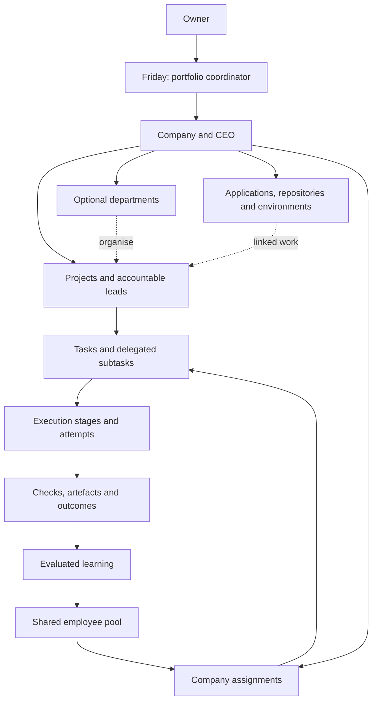
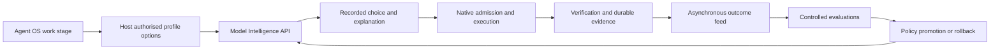

# Agent OS end to end execution plan

Date: 2026-10-27

Status: Consolidated product direction and implementation plan. The baseline below distinguishes existing code, the design prototype, and work still to deliver.

Agent OS operates a portfolio of companies through Friday, a reusable workforce and visible, accountable execution. Model Intelligence is a separate product that selects and improves model configurations through its own API. Agent OS is its first integration.

This is the master plan for the next implementation. It consolidates the [operating model](2026-10-25-agentos-operating-model.md), [capability inventory](2026-10-25-agentos-capability-inventory.md), [Friday design blueprint](../../prototypes/agentos-designs/friday/design.html), and [Model Intelligence architecture](2026-10-27-agentos-model-intelligence.md). It takes precedence where earlier plans describe different navigation, a Combined tab, or policy-adoption behaviour. Historical implementation and verification records remain intact.

## 1. Accepted product decisions

- Agent OS is the platform, built on the Paperclip fork. Internal platform maintenance is separate from the customer-company and application portfolio.
- Friday is the main voice-first interface and portfolio coordinator. She can navigate, explain, create work, delegate and surface decisions. CEOs and project/pipeline leads run the operations.
- Each company is a venture. Projects deliver outcomes; optional departments organise disciplines. Applications are durable products that projects develop, market or operate.
- Employees are persistent shared identities. Their company assignments have separate permissions, context, resource limits and adopted capabilities. Company-local retirement leaves other assignments intact.
- Retain profiles, skills, instructions, harness/model/seat configuration, direct employee chat, routines, artefacts, search, audit and recovery controls.
- Use the selected white Friday Canvas design, with a moving dot sphere, restrained meaningful colour, centre-canvas navigation, persistent context, and a bottom-right Friday presence while working.
- The eventual production target is cloud-native and independent of the owner's laptop. The latest owner decision is to prove the concept **locally first**. The briefly deployed Vercel/tunnel setup is deferred, and the public tunnel is stopped. Do not enable Google Cloud billing or provision a backend host. Mobile responsiveness, full core functionality, measured speed and controlled infrastructure cost remain requirements.
- Use **Kanban** for the board-only tab and **Agent Map** for the visual graph. Project Home brings work and activity together. No additional Combine or Combined tab is required.
- Every admitted autonomous workflow must expose its relevant operational actions, delegation, outcomes and learning through Agent OS. Provider selection depends on proving that contract.
- Use supported subscription execution where qualified. Do not silently switch to API billing, overage or paid voice. Multiple employees and profiles share the actual seat's capacity.
- Model Intelligence is independently deployable and usable through an API. Start it alongside Agent OS; call it at stage boundaries and send outcomes asynchronously.
- Proven low-risk routing improvements are adopted automatically for companies enrolled in the agreed operating policy. Larger changes become Decisions. Every adoption is versioned, inspectable and reversible.
- Friday changes Agent OS platform code only in response to an explicit owner request. Routine routing improvement does not grant authority to alter permissions, billing or platform code.
- Build directly in this repository through the current development session. The future Friday development workflow is a product capability to implement and prove, not a prerequisite for this work.
- Public visitors can register from an Agent OS landing page using Google or email/password. Registration creates a pending identity; an administrator approves access and assigns company membership. Human user accounts remain distinct from digital employee identities.
- `/admin` owns user review, company assignment, administrator roles, session/key revocation, suspension/deletion and an instance audit trail. It also hosts Model Intelligence observability, with unavailable learning evidence explicitly marked until the independent service is connected.
- Google sign-in belongs to the dedicated **AgentOS** Google Cloud project (`agentos-dave8284`), created on 27 October 2026. It must not share application configuration with SMVS or Semantic Satsang Search. Production domain and OAuth client setup remain external setup dependencies.

## 2. Baseline and completion boundaries

| Layer | Current evidence | Remaining delivery |
| --- | --- | --- |
| Paperclip foundation | Native companies, agents, tasks, adapters, connections, execution, approvals, routines, artefacts, logs and recovery owners exist | Adapt their presentation and extend missing contracts without duplicating those owners |
| Agent OS foundation | The fork contains application registration, Friday surfaces, portfolio/shared-employee/company-assignment records, scoped workforce operations and related tests | Complete delegated portfolio/CEO authority, capability adoption, account-wide admission and full operating journeys |
| Selected interface | The chosen white Friday canvas is now implemented in the React routes, with native company/project/decision records, board-only Kanban, coloured Agent Map, employee table and docked native conversation; see the correction checkpoint below | Qualify real-browser/mobile layout, microphone and audible replies; complete the remaining operating journeys |
| Model Intelligence | Independent-product architecture and execution plan are documented | Implement the service, host integration, outcome evaluation and automatic policy improvement |
| Registration and administration | Landing, approval state, Google auth wiring, account management, instance audit and recorded model analytics implemented; see [delivery notes](2026-10-27-agentos-registration-administration.md) | Configure the Google web client and domain, verify real sign-in/browser flows, then connect independent learning-service evidence and policy controls |
| Production autonomy | Some component and integration evidence exists in historical checkpoints | Qualify real end-to-end workflows, provider access, restart/recovery, release and rollback on the release revision |

The preview's Northstar, Forma and Arbor records are examples. They are not live companies or execution evidence. Previous component tests do not certify the final interface or production integrations. The current browser integration failure must be resolved before claiming visual, microphone and audible-reply acceptance.

### Production UI correction — 27 October 2026

The registration/admin delivery left the approved design in the HTML preview and retained the upstream navigation shell. The public landing page also inherited the application's document scroll lock. This checkpoint corrects that gap directly in the application repository.

- Public pages can scroll. Authenticated workspaces own a bounded, scrollable canvas instead of relying on the public document lock.
- The default application shell is Agent OS regardless of the upstream Streamlined UI setting. Native record/settings pages retain their controls and company context inside the new navigation. The upstream shell remains an explicit `?shell=classic` compatibility path.
- Friday Home uses the approved white canvas, dotted orb, company shortcuts and automatically surfaced decisions/blockers. Company cards open the centre canvas; project cards open scoped workspaces. Home, Kanban, Agent Map, Decisions, Routines and Artefacts retain company/project filters. Audit navigation remains visible. The employee table opens the existing profiles, skills, configuration and direct chat.
- The portfolio graph combines real company/project/agent/task/evidence records. Colours distinguish record types and states; pan/zoom and native record selection remain available. Partial pages and unavailable data are labelled, without invented activity.
- Talk uses the existing speech controls without opening a modal. The crossed-out microphone represents listening being off. Prefer to type opens a rounded conversation at the left of Home; workspace navigation docks Friday at the right. History, drafts, approval controls and sending remain owned by the native conversation. Native settings/record pages also expose the durable Friday conversation through a dock.
- Shared company context and route-prefix scopes keep embedded record links associated with their owning company; the URL of the portfolio coordinator does not override them. These presentation scopes grant no new authority.
- Browser title, manifest, favicon, loading, sign-in and bootstrap copy use Agent OS. Technical package names and external provider identities remain intact.

Verification: workspace build/typecheck passed, Storybook built, and 455 targeted tests across 16 files passed, including native chat, portfolio journeys, both legacy feature-flag states, company routing and access gates. Token gates and diff checks also passed. Browser integration still fails before starting (`missing field sandboxPolicy`), so these checks do not certify the rendered visual match or actual audio. The prior incomplete broad-suite run and its isolated heartbeat failures remain recorded in the registration/admin delivery notes; this checkpoint does not claim a full-suite pass.

This UI correction does not complete the independent learning service, cloud deployment or every autonomous company workflow in the plan.

### Interaction refinement and local-backed Vercel rollout — 27 October 2026

- Friday's canvas transcript opens only through an explicit orb/type interaction. Errors and pending input update presence without opening chat. Home conversation is borderless and inline beside the orb; narrow layouts stack it in the same canvas. Native task-thread recovery controls are retained.
- The Agent Map uses pastel record halos, curved relationships, neighbour focus and an inspectable record preview. Only real running work animates. Zoom/pan/reset and reduced-motion/hidden-page behaviour remain available.
- Company, project and task cards/details now expose native deletion with typed-name confirmation. Company/project archive is an alternative. Dependencies and retained workspaces remain server-owned blockers; project dependency conflicts return a useful 409. Archived projects are omitted from default work cards while their scoped history remains accessible.
- Vercel account confirmed by the owner: `dave8284`, team `sids-projects-4c176c0e`. Project `agent-os` reserves `https://agent-os-ivory-mu.vercel.app`. The backend, database, agent seats and workspaces remain on the owner's computer.
- The public interface proxies API/plugin requests through an HTTPS tunnel and a loopback gateway. The gateway adds a restrictive marker; the native HTTP server rejects marked HTTP and WebSocket requests unless public authenticated mode is active. It also rejects development source/control paths. The marker grants no identity or company access. Native authentication and pending-user approval remain authoritative.
- The transport gate belongs in the native HTTP listener because Express alone cannot guard the runner/plugin/live-event upgrade listeners. Direct local requests retain their existing behaviour. It performs no database checks or background polling.
- Google credentials remain private on the local backend. `scripts/configure-agentos-google.mjs` validates the dedicated Google project and exact registered callback before importing a downloaded Web client. No client secrets or database files are included in Vercel's static upload.

Verification: the refinement run passed 333 tests in seven files; an overlapping 66-test acceptance run, full workspace build/typecheck, Storybook build and token gates also passed. Tunnel admission adds real HTTP/upgrade tests, and the local gateway is exercised for body/cookie/redirect forwarding, live duplex traffic and backend outage. A server typecheck initially found an event-emitter overload mismatch; that was corrected and the server typecheck passed. This does not claim the previously incomplete broad regression suite or browser/microphone acceptance is complete.

Current deployment and operational evidence is maintained in [the local-backed Vercel runbook](../agentos-vercel-local.md). Google sign-in still requires the owner's downloaded Web client and a real browser sign-in/ownership claim.

Latest decision: after reviewing cloud costs, the owner requested local operation until the concept is proven. The public gateway/tunnel LaunchAgents were stopped and moved out of automatic startup. The backend is restored to loopback-only `local_trusted`/private mode with localhost URLs, preserving the existing database. Vercel retains its project and static deployment but cannot reach the local workspace. Normal proxied HTTP was verified during the rollout; public WebSocket forwarding failed (the rewrite returned a native API 404) and remains unresolved. The experimental relay was not retained in source. No remote dashboard or Google sign-in completion is claimed. Local functional, browser/mobile/audio and broad-suite qualification remain the priorities.

## 3. Company and work structure

| Object | Meaning and ownership |
| --- | --- |
| Portfolio | The owner's authorised companies and shared workforce; Friday coordinates across it |
| Company | A venture with a profile, CEO, goals, resources, operating mandate and adoption policy |
| Department | Optional stable function such as Engineering, Product, Marketing, Sales or Operations; a grouping and reporting dimension |
| Project | An outcome or ongoing initiative with one accountable lead, scope, participating employees and success measures |
| Application | A durable product with repositories, deployed environments, connections, health and release history; several projects may support it |
| Task | One independently owned piece of work, with acceptance criteria, dependencies, artefacts and a native task lifecycle |
| Stage | A meaningful step within a task, such as investigate, design, implement or verify; it can have several execution attempts |
| Run or attempt | A specific execution using a recorded harness/model/profile, with observed events and outcome |
| Routine | An owned, versioned trigger and workflow definition that creates attributable instances of work |
| Decision | A human choice over an exact proposal or genuine unresolved exception, projected from native records |

Departments do not create a second work tree. A department board is a filtered view of the same tasks, and a project can involve several departments. A project can exist without an application, for example market research. An application does not become a substitute for a company.

## 4. Authority and delegation

Friday receives explicit portfolio grants and checks the target company's permissions for each operation. A company CEO controls its company within its mandate; a project lead controls the assigned work and can recruit/delegate within that scope. Child agents receive bounded capabilities rather than inheriting unrestricted access.

The same shared employee can hold assignments in several companies. Native agents and execution contexts remain company-scoped. Shared identity does not imply shared browser sessions, credential stores or unrestricted memory. Owner conversations can aggregate authorised assignments; a CEO's conversation cannot reveal another company's work through the employee.

The operating mandate defines allowed actions, connectors, hiring authority, publication/release authority, resource caps, escalation conditions and change limits. Agents carry out ordinary authorised substeps without asking repeatedly. A material scope expansion or an action outside that mandate becomes a Decision. Revocation is checked again at execution, including delayed and resumed work.

CEO staffing actions record the assignment, evidence, reason, author, capability version and lifecycle result. Ending an assignment uses the native retirement/cleanup path and preserves history. It does not remove the employee globally. Friday or the owner manages portfolio-wide identity and global retirement separately.

## 5. How requests become work

1. Friday identifies the intended outcome, company/project context and existing authority. Ask only for missing information that materially affects the work.
2. Inspect current work, repositories, artefacts, incidents and active routines before creating overlapping tasks. Reuse or link an existing initiative where appropriate.
3. The CEO or lead writes a short versioned brief: purpose, boundaries, acceptance criteria, risks, dependencies, limits and success measures.
4. Break the outcome into deliverables. Create subtasks when an independently owned output, parallel branch, review or handoff warrants one. Ordinary reasoning and tool calls remain events within a task.
5. Assign one accountable employee to each task. Register delegated work with its parent before giving it company resources. The parent remains responsible for integrating and verifying the result.
6. Define stages and dependencies. Parallelise independent work; sequence work that changes the same resource or depends on another result. Use isolated branches/workspaces and a clear integration owner.
7. Select qualified execution profiles, reserve capacity, record the admission and dispatch through the native executor.
8. Verify outputs against acceptance criteria. Record repairs, escalation, rejection or completion. Provider completion alone does not mean the task is accepted.
9. Publish or deploy under the approved mandate, observe the result, and feed verified outcomes into company knowledge, employee improvement and model-routing evaluation.

A plan diagram is an explanation of the workflow. Enforced stage gates require validation in the owning execution service; writing a diagram does not create enforcement.

### Example feature breakdown

Illustrative request: “Add team invitations to our existing application.” This is not a reconstruction of the unattached image.

| Work | Owner | Deliverable and dependencies |
| --- | --- | --- |
| Clarify and inspect | Product lead | Existing behaviour, target users and acceptance criteria |
| Design permissions | Engineering lead | Tenant isolation, roles, token expiry and recovery design |
| Implement server behaviour | Engineer | Invitation operations and permission checks; depends on design |
| Implement interface and email | Engineer/designer | Form, states and approved copy; parallel where interfaces are agreed |
| Verify | QA/reviewer | Positive, negative, cross-tenant and regression checks; findings create bounded repairs |
| Release | Operations lead | Approved build, deployment receipt, health checks and rollback reference |
| Explain and observe | Product/growth lead | Release notes, relevant onboarding changes and a feedback routine |

The model service can select different profiles for these stages. It does not replace the lead or create a competing organisation. The same structure supports campaigns, research, sales follow-up and incident response, with different acceptance criteria.

## 6. Task contract and states

Each task retains its native ID and records company/project/application links where relevant, department, parent, one assignee, priority, dependencies, brief and revision, acceptance checks, allowed resources, limits, stages, decisions, outputs and audit references. Each attempt links the employee assignment, parent/child runs, effective instructions and skill versions, selected profile, actual observed model, inputs, tools, results and checks.

Preserve native task states: `backlog`, `todo`, `in_progress`, `in_review`, `blocked`, `done`, `cancelled`. Suggested Kanban columns are To do, In motion, Review, Blocked and Done. Backlog remains identifiable within To do or a filter; cancelled work remains accessible through history/filtering and is not counted as completed.

Task state, run state and employee availability are distinct. A task may be in progress while an attempt waits for capacity. An employee may have several queued assignments and one active run. The interface must show these facts without marking all assigned work as currently executing.

Task detail has Overview, Execution, Artefacts and Conversation, with linked Decisions and dependencies. Execution displays the stage timeline, attempts, model choices, published analysis, tools, checks and recovery. Native checkout, status revisions, idempotency and authority remain the mutation boundary.

## 7. Layout and navigation

Use the selected “A little clarity, a lot in motion” design as the visual direction. Build it into the production React shell using the design-token layer; do not embed the HTML prototype as the application.

The page uses white surfaces, charcoal text, quiet neutral borders, rounded controls and restrained semantic colour. Replace the six-dot brand with a small version of Friday's dot sphere. The primary content is the centre canvas. A right context rail can show evidence, changes and short updates where useful; it does not crowd the full-width Kanban board.

| Navigation | Behaviour |
| --- | --- |
| Agent OS brand | Return to Friday home |
| Work | Portfolio work overview, with company/project/employee filters |
| Companies | Venture cards and their health, active work and pending decisions |
| Decisions | All authorised pending decisions, grouped by company and project |
| Agent Map | Portfolio graph, with immediate company/project drill-down |
| Left navigation | Companies; selected company's projects; local tabs and scope; persistent while inspecting Audit Trail |
| Workforce and employee selector | Workforce table plus quick access to employee profiles and conversations; reachable from the left utility area |
| Utilities | Search, Audit Trail, connections/settings, saved views and advanced controls |

Company and project clicks render centrally. Use typed destinations and one navigation contract for clicks, voice and generated links. Preserve breadcrumbs, browser Back, filters, selected scope and meaningful deep links. Avoid duplicate prominent entry points for the same work.

On narrow screens, navigation becomes an explicit drawer and the context rail collapses. Keyboard navigation, focus movement, readable labels, reduced motion and non-colour status cues are part of acceptance.

### Mobile interaction contract

Use one responsive web application with the same authorised capabilities on phone, tablet and desktop. An installable web-app shell can follow the core mobile journeys; it must not become a separate implementation or a prerequisite for using Agent OS.

| Surface | Phone behaviour |
| --- | --- |
| Friday home | Central dot orb and reachable voice control; transcript becomes an inline expandable area above the keyboard rather than a desktop-sized floating panel |
| Working presence | Compact dock clear of device safe areas, browser controls and primary actions; history opens as a fitted side/full-height sheet |
| Company/project navigation | Explicit drawer, persistent scope label and visible back/breadcrumb control |
| Decisions | Single-column proposal/evidence view with reachable approve/decline controls and the exact company/project context |
| Kanban | One column at a time or horizontal column navigation; provide a non-drag status action so touch users can do the same work |
| Workforce | Compact table with priority columns, expandable row details and accessible additional columns; all employee controls remain reachable |
| Agent Map | Touch pan/pinch, fit and zoom-to-selection, clustered records and a bottom inspector sheet; a list equivalent exposes the same records |
| Artefacts/generated canvas | Responsive tables/charts, bounded horizontal scrolling where needed and an explicit full-screen viewer |

Design for at least 360px-wide phones, tablet and desktop layouts. Use generous touch targets, readable text, keyboard-safe composition, screen-reader labels and reduced motion. Pause off-screen/decorative animation and use graph aggregation to control battery and rendering load without removing access to records.

Verify real microphone capture, playback, interruption, tab suspension, orientation changes, poor connectivity and recovery on iOS Safari and Android Chrome as well as desktop browsers. Keep voice in an explicit foreground session; do not promise background listening before it is supported and qualified. A closed phone browser does not stop cloud agents.

Cache static assets and permitted view data deliberately. Label stale/offline information. A typed action or decision is pending until the server confirms it; do not silently submit a stale approval when connectivity returns. Permission-revoked and signed-out data must not remain available through an uncontrolled cache.

## 8. Friday interaction

### Home

Friday is a pulsing, moving sphere made of dots, with a clear state beneath it. “Talk to Friday” starts microphone capture without a modal. Display Listening only after capture actually starts. A slashed microphone means no active capture, including paused, permission-pending, denied and failed states. It becomes unslashed only while listening.

Typing stays small until requested. “Prefer to type” reveals a rounded inline conversation area to the left of Friday. Ordinary conversation stays on the home screen. An explicit navigation or display request opens the appropriate centre-canvas content. Clicking the orb can open conversation history.

Show decisions and blockers automatically, grouped by company/project, without repeatedly moving the user away from their current work. Alerts do not silently turn on the microphone. No primary New Chat flow is needed; create Task, Project or Company establishes the work boundary within the continuous conversation.

### While working

Friday moves to the bottom right and remains available across routes. Clicking the docked orb opens a right-side history panel with typing. Do not add a second typing control that opens a central modal. Keep conversation, pending sends and voice state through navigation.

Support speaking, interruption, transcript correction, mute, permission errors, reconnect and an accessible text fallback. Avoid hearing and resubmitting Friday's own playback. A spoken yes/no binds to the identified proposal revision; uncertain recognition or submission requires clarification/reconciliation rather than duplicate execution.

### Awareness and tools

Friday reads authorised company/project/employee work, routines, artefacts, connections, capabilities, health, decisions and audit. Answers cite the relevant records and their freshness. Use bounded retrieval and event-driven updates rather than injecting the whole portfolio into every prompt. A shared employee can explain its authorised assignments through the same retrieval boundary.

Friday can search the web through a qualified tool, create or navigate work, recruit appropriate leads and surface reports. These capabilities are registered, discoverable and permission-checked. An instruction claiming access is not evidence that a connector or tool is available.

## 9. Company and project workspaces

| View | Company scope | Project scope |
| --- | --- | --- |
| Home | Company profile summary, application/project cards, active work, decisions, health and recent outcomes | Objective, lead/team, remaining and active tasks, milestones, decisions and recent evidence |
| Kanban | Tasks across projects, grouped/filtered as requested | Only this project's tasks; board-only content |
| Decisions | Company decisions grouped by project, plus company-level decisions | Only decisions relevant to this project |
| Agent Map | Projects, assignments, tasks, resources and activity for this company | This project's work graph and related evidence |
| Routines | Company-level and project-level routines belonging to the company | Only routines assigned to this project |
| Artefacts | Company outputs, searchable by project/task/author | Project outputs and their versions/provenance |
| Workforce | Company assignments, leads, capability adoption and workload | Participating employees and their project work |
| Profile or settings | Mission, goals, CEO, departments, brand/knowledge, operating mandate and connections | Brief, application links, limits, resources and success measures |

Empty states offer a relevant next action through Friday or a direct control. Agents may create projects, tasks, routines and artefacts under their grants. That work appears in ordinary lists and totals; automated work is not silently hidden by default.

## 10. Agent Map and execution visibility

Use spiral/constellation placement to organise real data. Every point resolves to a company, project, assignment, task, run, source/resource, decision or artefact. Every edge has a meaning: ownership, dependency, delegation, communication, permission, observed read/write or produced output.

Keep Structure and Activity modes distinct. Permission to access a dataset is different from an observed access. Motion comes from recorded activity. The Friday presence animation indicates conversation state and does not claim business work occurred.

The initial palette is teal Friday, blue companies/projects, violet assignments, amber pending work, cyan active work, green completed work and terracotta evidence. Add explicit labelled states for review, blocked, failed and unknown records as live data is connected. Colour is supplemented by text, shape/outline or badges and a legend.

Provide zoom in/out, fit, zoom-to-selection, pan, breadcrumbs, back to company/portfolio, search and filters. A selection opens an inspector with owner, task/stage, latest action, exposed analysis, source data, model/attempt history, outputs and freshness. It links to the full task or employee page.

Large graphs aggregate authorised clusters and show exact scoped counts with explicit expansion/pagination. Layout positions should remain stable as events arrive. Support a historical time window using recorded events, not re-execution. The graph, Kanban, dashboards and Friday answers use the same authorised records and reconcile their totals.

Add an optional model lens after execution receipts exist. Its legend explains profile/model choices separately from task status. Do not create ornamental data points or animate inferred activity to fill a quiet graph.

## 11. Decisions and audit

Decisions aggregate native approvals, interactions and unresolved exceptions with company, project and task links. Each shows the proposed action, why it needs the owner, recommendation, alternatives, consequences, supporting evidence and exact revision. Allow voice or direct resolution through the original service's authority and revision checks.

Use Pending, Resolved and History filters. Preserve rejection, revocation, expiry and superseded proposals. Operational problems already being handled by agents should appear as status, not unnecessary requests for a yes/no.

Audit Trail retains left navigation and scope. Filter by company, project, task, employee, routine, model/policy, action type and time. Link from every staffing, permission, model selection, learning promotion, deployment and decision event to its evidence. An eventual success does not remove the preceding failure.

## 12. Workforce and capability cultivation

The Workforce table shows name, specialty, assignments, current/queued work, state, skill/capability version, harness/model profile, account connection and capacity/limits. Clicking an employee opens Overview, Assignments/Work, Conversation, Skills/Instructions, Execution/Access and Learning/History. Show provenance: upstream template, custom role, adopted revision and evaluation evidence. Installing a role is not proof of expertise.

Company CEOs can recruit existing specialists, create approved new assignments, refine them and retire their own assignments within limits. Project leads can request or obtain help within their delegated mandate. Record staffing decisions and successor lineage rather than deleting unsuccessful agents from history.

Cultivation follows observation → failure/learning candidate → proposed skill or instruction change → sandbox evaluation → versioned publication → company adoption → outcome monitoring/rollback. Test useful capabilities against representative tasks. Maintain company knowledge, attributable employee experience and general reusable methods as distinct scopes.

The user's automatic-adoption decision specifically covers proven low-risk routing improvements within an approved company policy. Shared employee skill releases still follow each company's adoption mandate. A company can authorise limited automatic capability updates separately; a global publication does not itself authorise changing all assignments.

## 13. Routines and operating loops

Each routine has an owner, company/project scope, versioned steps, trigger, inputs, success measures, limits, escalation conditions and pause/resume controls. An execution instance links the routine version to its tasks, attempts, outputs and outcome. The native scheduler remains the single scheduling owner.

Support schedules, authorised webhooks/events and completion dependencies. Prefer event-driven work and deterministic checks to repeated empty model polling. Deduplicate triggers and enforce concurrency, retry, backoff, no-progress and total-resource limits. UI closure does not stop background work; a paused routine stops admitting new work and reconciles effects already in flight.

| Operating loop | Sequence and observable outcome |
| --- | --- |
| Engineering/product | Feedback → triage → evidence-backed backlog → priority/decision where needed → build → verify → release → observe |
| Production operations | Health/error signal → classify → investigate → authorised repair or Decision → verify recovery → incident record and prevention work |
| Marketing | Research/brief → create assets → verify/review under mandate → publish → collect feedback/results → evaluate → revise |
| Sales/support | Incoming signal → authorised context → draft/action within mandate → follow-up → measured outcome → learning |

TikTok, LinkedIn, Higgsfield, GitHub, Vercel and Google Cloud are requested integration targets, not presumed connected capabilities. Qualify each required action through a supported connection. A marketing routine can use different providers for creation, publication and measurement while retaining one accountable lead and one execution history.

Choose outcomes that match the business objective. Views or likes alone do not establish commercial success; delayed and confounded results retain that uncertainty. Uncertain external publications or deployments must be reconciled before another attempt.

## 14. Existing and new applications

For an existing repository, Friday/lead discovers branches, active changes, open work, PRs/checks, architecture, environments, release process and known incidents. Record an adoption baseline. Preserve unfinished work and repository history. Propose a prioritised operating agenda within the user's authority; broader cloud/publishing actions require the relevant connection grants and mandate.

For a new application, start with the company brief and CEO, select a team, create projects, define acceptance criteria, establish the repository/environments through authorised tools, implement, verify and release. The company can exist before the repository.

Application detail links its development, marketing and operations projects, environments, deployment version, health, incidents, releases and rollback evidence. A human's GitHub CLI access used to build Agent OS does not automatically become an agent's production/cloud permission.

## 15. Artefacts, knowledge and generated canvas

Artefacts retain producing company/project/task/employee/run, source inputs, revision/digest, review state and destination where published. Preview and download supported documents, code changes, images, videos, reports and releases through existing work-product/storage owners. Retain revisions; clearly distinguish a saved snapshot from a live view.

Search spans authorised companies, projects, tasks, employees, conversations, routines, knowledge and artefacts, with scope filters and provenance. Retrieval respects private resources as well as company membership. Memory entries record their source, validity and adopted versions. Generalise methods before sharing; never copy another company's private facts into a reusable skill.

Friday first renders requested content using registered typed components: tables, charts, lists, timelines, comparisons, task boards and document previews. Bind them to authorised queries. Repeated useful layouts become named versioned saved views with current data, not cached unlabelled answers.

Where custom code is necessary, render it in an isolated preview with bounded resources and no parent credentials or unrestricted platform access. Allow only explicit typed data/actions through a controlled bridge. Generated content cannot impersonate a native approval or alter the platform. Promoting a display into a privileged component follows the requested platform-change workflow.

## 16. Independent Model Intelligence product

The detailed contracts and evaluation design remain in the [Model Intelligence plan](2026-10-27-agentos-model-intelligence.md). Its product boundary is:

Build the selection/learning core as an independent library within its own API service. Give the product its own contracts, SDK, schema/migrations, authentication, tenant isolation, evaluation jobs, health checks and deployment package. A reference host must work without Paperclip. Agent OS-specific integration code translates its records; the product core imports no Paperclip runtime or database types.

Initially run the service alongside Agent OS. Routing happens at a task/stage boundary, with cached qualified profiles and fast policy lookup. An additional model classification call is reserved for ambiguity that justifies it. Model tokens and ordinary tools stay on the native execution path. Outcomes and heavier learning jobs run asynchronously, with durable delivery and idempotency.

Extend the existing connection-router/plugin boundary to select among several qualified model/effort profiles on the same account. Keep one account capacity identity. Do not duplicate accounts to represent models. Preserve legacy pool behaviour and existing session pins. Handoffs occur at explicit validated checkpoints with their own attempt and provenance.

The service chooses within host-authorised options; Agent OS revalidates grants and acquires capacity before execution. The service cannot grant permissions, hold model credentials, execute business actions or bypass budgets. Missing qualification/funding information produces a wait or unavailable result, not a guessed route.

## 17. Learning and automatic improvement

Optimise the full configuration: model, reasoning effort, harness, approved prompt/context strategy and skill versions. Measure first-pass and final accepted quality, rework, elapsed time, observed usage and business outcomes. Separate model turns, transport retries, repair attempts and workflow retries. Optimise total resources per accepted result subject to a quality floor.

Start with an explainable baseline. Build representative evaluation sets from authorised evidence, retaining failures and held-out/time-separated examples. Compare prompt, context and model changes using controlled variants. Shadow recommendations do not establish alternative-model performance; run bounded sandbox evaluations to obtain that evidence. Experiments do not repeat production side effects.

The approved automatic policy is:

| Change | Behaviour |
| --- | --- |
| Better routing/effort or approved prompt/context configuration within the same qualified action, funding and risk limits | Evaluate, canary, adopt automatically for enrolled companies, audit and notify in a concise summary |
| Quality, usage or coverage regression | Stop promotion; revert to the last qualified policy and record the reason; escalate if the operating mandate cannot be maintained |
| New provider, account/funding class, materially new capability, broader data access, larger risk/budget or platform code change | Surface a Decision or obtain the already-required explicit owner instruction |
| Sparse data or uncertain outcome | Keep the current qualified baseline and collect evidence; no invented success or forced promotion |

Define measurable quality floors, allowed regression, evaluation resource caps, canary scope and rollback triggers per task family before enabling automatic adoption. New companies can enrol through the approved operating mandate without requiring per-update approval. Existing pinned policies remain pinned until enrolled. In-flight work keeps its recorded configuration until a safe handoff.

Friday and productive company work have priority over bounded experiments. Use deterministic validation where possible and independent model/human review where risk or quality warrants it. Candidate evaluators cannot approve their own policy changes solely on self-reported confidence. More advanced adaptive exploration can follow only after sufficient reliable data and within low-risk limits.

Cross-company learning shares evaluated methods and authorised aggregate evidence. Raw private transcripts, source files, credentials and context remain scoped. Cross-customer learning in the separately packaged product requires explicit participation. This improves routing and working methods; it is not an initial foundation-model training project or a guarantee of perfect outcomes.

## 18. Execution evidence and recovery

Attach capture before dispatch. Register task, assignment, parent/child identities, stage/attempt, effective inputs and allowed resources. Persist action intent before controlled effects and a result or explicit unknown outcome afterward. Track requested and provider-reported effective models separately. Runtime-exposed analysis is labelled; unavailable private reasoning is not invented.

Combine native run events, instrumented tool/gateway receipts and source-system results. Tool instructions asking an agent to report progress are useful but insufficient as the enforcement mechanism. Shell, browser, network and connector paths must meet the same authority/capture contract. An opaque delegated path that cannot meet the contract is not qualified for that workflow.

Use durable sequence/source identities, duplicate suppression, reconnect catch-up, fenced ownership and transactional outbox delivery. The native execution log remains authoritative for actions; Model Intelligence owns selection/evaluation records, with linked immutable receipts in Agent OS. Keep local business evidence distinct from optional tracing and first-party telemetry.

If required durable capture fails, stop admitting controlled actions, preserve queued work and reconcile in-flight effects. A stop request is distinct from confirmed remote termination. Do not start overlapping replacement work while the previous outcome is unknown. External idempotency and reconciliation are required; do not promise exactly-once effects from providers that cannot support them.

Persist work through process restart, account expiry, quota waits and service outages. Reserve seat capacity atomically across authorised companies and employee/profile aliases, with fairness and interactive Friday priority. Provider-wide usage observations may include other activity; retain attribution uncertainty. Allow a routing-service fallback only to an explicitly approved, still-qualified static policy, otherwise queue.

## 19. Platform evolution and deployment

An owner request to Friday creates internal platform engineering work: scope → lead/team → branch/worktree → implementation → checks/review → staging → authorised release → health verification → outcome. Link the request, tasks, commits/PRs, migrations, artefacts, release version and rollback record. Autonomous detection of a missing feature can propose work but cannot authorise a core change.

Keep release, stop and rollback controls usable outside the process being replaced. Preserve active runs and durable obligations during handover. Test database and artefact restoration as well as code rollback. Platform Operations is clearly identified internal work and excluded from the ordinary customer-application portfolio.

Production Agent OS needs a persistent authenticated server, durable database, execution workers, protected credentials and artefact storage. Application frontends may be deployed to Vercel and applications/services to Google Cloud where qualified. Choose the actual Agent OS hosting destination before the production release; the execution architecture must support the selected harness's operating environment. No hosting account is assumed provisioned by this plan.

### Cloud deployment architecture

Production runs independently of the development machine. Package the web/API, native execution workers and Model Intelligence as reproducible containers, with versioned infrastructure configuration, health/readiness probes, service identities, protected secrets, graceful shutdown and automated deployment/rollback. Use separate development, staging and production configuration; prevent preview environments from operating production resources.

Start in one selected region close to the primary users and required data, keeping the API, model service, database and storage colocated where practical. Choose the smallest measured configuration that meets the agreed latency and recovery targets. Logical product independence does not require a large fleet of services or an initial Kubernetes cluster.

| Layer | Proposed initial shape | Cost and performance rule |
| --- | --- | --- |
| Web assets | Static React assets with cacheable delivery; use the existing hosting provider where suitable | Cache versioned assets; lazy-load graph, media and advanced administration code |
| Agent OS API and live views | Container service with external durable state | Keep enough warm capacity for interactive latency; tune concurrency after correctness and load tests |
| Native scheduler/dispatcher | One fenced logical scheduling owner using durable obligations | Preserve existing scheduling semantics; add a cloud wake/transport only where needed, without another business scheduler |
| Harness workers | Isolated cloud execution environments with explicit leases, workspaces and bounded resources | Scale with runnable work and available seats; reuse qualified environments safely; stop idle workers after checkpoint/cleanup |
| Model Intelligence | Independent container/API in the same region, with its own data boundary | Fast local-policy routing, cached profile metadata and separate bounded background evaluations |
| Database | Durable PostgreSQL with backups, connection pooling and independently scoped service credentials | Start small; select availability and recovery settings deliberately; measure connections, query latency and storage growth |
| Artefacts/workspaces | Object storage for durable outputs and checkpoints; appropriately isolated working storage | Direct scoped transfers, lifecycle/retention rules and bounded media previews; instance disks are not the record of work |
| Connections/secrets | Managed secret storage, service identities and qualified provider authentication | No dependency on a developer's local credential files; never bake user tokens into images |

Given the requested Google Cloud integration, qualify Cloud Run for the API/model services, managed PostgreSQL and object storage as an initial deployment candidate. Qualify worker pools, jobs or a container worker on suitable compute against the actual harness's process, filesystem, browser and sandbox requirements. Do not force an incompatible harness into a short HTTP request. Vercel remains an application/frontend hosting option; avoid paying for duplicated hosting layers without a measured benefit.

Agent OS and Model Intelligence can initially share a managed PostgreSQL instance through separate databases or schemas and restricted roles. The model product owns its migrations and export/restore path, has no cross-product foreign keys or direct access to Agent OS tables, and can move to another database through configuration. This saves infrastructure while preserving the product boundary; account for the shared instance's failure and capacity limits.

Cloud Run's documented background CPU and minimum-instance behaviour make the API/worker distinction consequential: request-based services must not rely on detached background work, while keeping a minimum instance can reduce startup delays. [Cloud Run development guidance](https://docs.cloud.google.com/run/docs/tips/general)

Its ordinary container filesystem does not preserve data when the instance stops; durable work and secrets therefore need external storage. Runtime privilege and filesystem constraints also belong in harness qualification. [Cloud Run container contract](https://docs.cloud.google.com/run/docs/container-contract)

Live clients must reconnect and catch up from durable cursors. Cloud Run streaming connections are subject to request timeouts, and reconnects may land on another instance. Session affinity is not a substitute for shared state. [Cloud Run WebSockets guidance](https://docs.cloud.google.com/run/docs/triggering/websockets)

Before scaling the existing server beyond one instance, audit process-local queues, timers, caches, websocket subscriptions, task pins and lifecycle ownership. Move authoritative state to native durable owners and add cross-instance event delivery and fencing. Use a bounded single-instance deployment until that proof exists. Cloud hosting alone does not establish scale-out correctness.

Subscription execution must be qualified in the intended cloud environment, including supported sign-in, renewal, restart and unattended operation. A working local login is insufficient evidence. The final cloud operating path cannot rely on the owner's laptop remaining online; report a concrete provider limitation before substituting another funding or execution mode.

### Cost control without weakening the product

Minimise cost subject to the agreed functional, quality, latency and recovery requirements. Keep the interactive path responsive; scale down idle execution, previews and experiments. Do not reduce audit completeness, company isolation, backup protection or acceptance checks to achieve a lower bill.

Maintain one cost view separating infrastructure, existing model subscriptions, permitted external media/tool charges and learning experiments. Show cost by company/project where attribution is supported, with shared overhead and unknown amounts labelled. Estimate the idle baseline, ordinary workload and peak case before provisioning, then compare the estimate with observed use.

Control worker/job concurrency, model calls, retries, experiment volume, environment lifetime, storage growth, log retention and outgoing media transfer. Use backpressure when capacity is exhausted. Reuse the existing durable queue/outbox where suitable; introduce additional infrastructure only for a measured requirement.

Set billing alerts and explicit application/resource admission limits. Provider alerts alone are not enforcement. Where supported, provider spend caps are an additional control whose stop/recovery behaviour must be planned; avoid unexpectedly taking away the owner's dashboard and recovery controls while trying to pause expensive workers. Google documents both alerts and Cloud Run spend-cap behaviour. [Cloud Run cost guidance](https://docs.cloud.google.com/run/docs/tips/services-cost-optimization)

Use cached authorised reads, incremental event updates, indexed queries, pagination, graph level-of-detail and media thumbnails to reduce compute and network use while retaining full drill-down. Keep routing and learning off the per-token/per-tool critical path. Compare warm-capacity cost with measured cold-start delay before choosing scale-to-zero settings for an interactive service.

### Speed and operating targets

Treat these as initial product targets to validate on a named reference device, network and representative dataset, not current measured results:

- Immediate visible acknowledgement of taps, typing and voice initiation; target within 100ms for local UI feedback.
- Ordinary authenticated workspace navigation within one second at p95 once the app is loaded, with useful loading states during slower requests.
- Warm policy-only routing below 100ms at p95 within the region; measure cold starts and model-assisted classification separately.
- Live activity displayed within two seconds at p95 after durable event commit under the qualified load.
- Smooth, usable touch interaction with graph aggregation; all underlying records remain accessible through expansion or list view.

Measure voice capture-to-transcript, submission-to-first-response and response-to-audible-playback separately. Set their release budgets during harness/voice qualification; do not conceal model or seat-queue delays behind a listening animation. Track infrastructure cost, queue age, event lag and p95 latency together when changing capacity. If a cost target conflicts with required speed or recovery, present the measured alternatives before cutting functionality.

## 20. Ownership and migration strategy

| Concern | Existing owner or planned boundary |
| --- | --- |
| Friday shell/navigation/voice | `ui/src/pages/Friday.tsx`, Friday components and `ui/src/lib/friday-navigation.ts`; introduce a persistent shell/provider around native surfaces |
| Portfolio/workforce | `server/src/services/agentos-workforce.ts`, matching routes and shared/db contracts; extend delegated authority and version references |
| Tasks/projects/company profiles | Native services and schemas; extend narrowly for required scope/stage metadata and typed projections |
| Applications | `server/src/services/managed-applications.ts` and existing APIs/UI |
| Routines and business effects | Native routines, scheduler, tool connections, execution and lifecycle owners |
| Decisions and conversations | Native approvals, interactions and durable chat; portfolio views resolve original records |
| Artefacts and audit | Work products/documents/storage, activity log and run events |
| Model integration | Existing AI connection-router/plugin boundary, native grants, account runtime and adapter-owned protocols |
| Independent product | `services/model-intelligence/`, portable contracts/SDK and independent storage/deployment |

Keep schema/API changes synchronised across database, shared validators, server and UI. Use additive migrations with baseline backups, preserved IDs/history and restoration exercises. Do not backfill imagined runs, learning or historical model evidence. Extend native documents and handoffs where adequate; add dedicated records only for enforceable capabilities or versioned domain state that is genuinely missing.

Maintain an upstream remote and a fork-change inventory to make future Paperclip updates reviewable. Preserve attribution and review dependencies before separately distributing the model product. Its core should remain independent of Paperclip-specific source and packaging.

## 21. Simplifying Paperclip

Keep the engine: companies, native agents, tasks, checkout/leases, adapters, runner, accounts/grants, approvals, budgets, scheduling, logs, artefacts, lifecycle and recovery. Adapt their presentation into the selected Agent OS shell.

Move detailed provider/runtime administration and secondary controls behind settings/Explore or Friday. Consolidate duplicate dashboard/inbox/chat navigation. Hide unused experiments and optional launchers first. A hidden screen does not imply its APIs, records or background worker are unused.

Before archiving, record purpose, consumers, routes, schemas, active triggers, owner, replacement and restore steps in the capability inventory. Tag the source and preserve data compatibility. Remove code only after replacement and dependency checks; do not drop data merely because its navigation disappears. Restoring archived functionality is an explicit platform change.

## 22. Build work packages and dependencies

These packages are implementation work, not tasks already running through Friday. Each package includes its relevant code, contracts, verification and migration/rollback notes. Use focused reviewable commits and push to the fork; do not repeatedly ask the owner to approve routine development steps already authorised.

| Package | Concrete work breakdown | Dependency and completion evidence |
| --- | --- | --- |
| P0 Baseline and qualification | P0.1 inventory current code/data and historical failures; P0.2 snapshot/restore baseline; P0.3 qualify the actual subscription/harness and define observable-work contract; P0.4 record UI tokens/routes and release checks; P0.5 qualify cloud runtime, cost estimates and performance targets | First; report concrete limitations before changing account, billing or authority assumptions |
| P1 Organisation and authority | P1.1 complete portfolio/Friday grants; P1.2 CEO/lead mandates and scoped tools; P1.3 departments, profile and application/project links; P1.4 assignment lifecycle and capability references; P1.5 public registration/Google approval gate; P1.6 human user administration and audit | P0; two companies share one employee while context, grants and retirement remain isolated; unapproved human identities cannot enter company execution or obtain delegated authority |
| P2 Production Friday shell | P2.1 token-based white shell and routing; P2.2 persistent orb/voice/history/inline typing; P2.3 native company/project/task and decision read paths; P2.4 accessible responsive navigation and legacy deep-link handling; P2.5 phone/tablet voice, Decisions, tasks and map flows | P0, with P1 for portfolio writes; real records replace fixtures and conversation survives navigation |
| P3 Recorded execution | P3.1 stage/attempt/child registration; P3.2 intent/result and protected evidence; P3.3 seat-wide admission/limits; P3.4 stop/restart/reconciliation and live projections; P3.5 cloud worker/state/stream qualification | P0/P1; one real task and delegated subtask can be reconstructed, including failure and recovery |
| P4 Independent model product | P4.1 portable API/contracts/SDK; P4.2 service/storage/auth/reference host; P4.3 baseline profile selection and receipts; P4.4 standalone package/health/export foundations | Can begin after P0 alongside P1–P3; reference host runs with Agent OS absent |
| P5 First complete operating journey | P5.1 create/select company and project through Friday; P5.2 lead decomposes work and delegates; P5.3 native execution, verification and scoped Decision; P5.4 inspect live task/map/audit and resume after restart | P1–P3; one observable end-to-end journey before expanding automation |
| P6 Full workspace and workforce | P6.1 Home/Kanban/Decisions/Routines/Artefacts scopes; P6.2 shared employee table/profiles/direct chat; P6.3 live Agent Map with meaningful activity and large-graph handling; P6.4 search/audit/provenance and reusable typed canvas | P2/P3; counts and permissions reconcile across all views, including automated work |
| P7 Routing integration | P7.1 model options beneath one account via versioned host contract; P7.2 decision persistence/native revalidation/outcomes outbox; P7.3 shadow evaluation; P7.4 bounded live routing and visible repair/escalation | P3/P4/P5; no duplicate quota, hidden fallback, incompatible session switch or unrecorded attempt |
| P8 Application operations | P8.1 existing/new onboarding; P8.2 GitHub/environment qualification; P8.3 build/release/health/rollback journey; P8.4 feedback-to-backlog and owned routine controls | P5/P6 and qualified connections; existing in-flight work is preserved and new work reaches a verified output |
| P9 Learning and workforce cultivation | P9.1 evaluation data and outcome quality; P9.2 controlled routing/prompt/context experiments; P9.3 automatic canary/adoption/rollback under mandate; P9.4 employee capability candidates, publication and company adoption | P7 plus sufficient verified outcomes; improvement shown on held-out work, failures retained and other companies' pins respected |
| P10 Cross-functional recurring workflows | P10.1 product/engineering loop; P10.2 production incident loop; P10.3 marketing creation/publication/feedback loop; P10.4 sales/support loop | P8 and per-provider qualification; each has a lead, real success measure, durable history and bounded recovery |
| P11 Generated extensions and platform evolution | P11.1 saved live canvas layouts; P11.2 isolated custom previews; P11.3 owner-requested platform change pipeline; P11.4 independent release/rollback control | P6/P8; generated code cannot gain platform authority and a requested feature reaches a verified staging/release path |
| P12 Release and product distribution | P12.1 full integration, mobile/browser, accessibility and load acceptance; P12.2 backup/restore, cost and health dashboards; P12.3 infrastructure-as-code and controlled cloud rollout; P12.4 standalone model-service install/upgrade/compatibility suite | All required workflow gates; exact release revision and remaining limits documented |

The initial delivery focus is P0–P3 and P5, with P4 built as a separate track. Expand the UI and business loops around proven execution. Automatic learning follows evidence collection; provider expansion follows demonstrated qualification. Do not defer observable behaviour or recovery until the final phase.

## 23. Verification and release acceptance

Every package tests observable behaviour through its owner and consumers. Include absent/disabled states and previous regressions. Run scoped checks during development, then required repository typecheck, tests, production build and relevant browser/integration checks for the release. UI token checks apply to production UI changes. Record failures and fixes rather than replacing them with a clean narrative after retries.

The release must demonstrate:

1. Speak to Friday, receive an audible reply, navigate without a modal and preserve the same conversation while docked. Mic-off state accurately reflects capture.
2. Create/navigate companies and projects; company Decisions/Routines aggregate their projects while project views remain scoped. Audit keeps navigation and Workforce remains a clickable table.
3. A lead creates meaningful tasks, delegates to registered employees, verifies the result and shows all attempts, artefacts and decisions in the native record.
4. Two companies use one employee with isolated context and independent retirement/adoption. A CEO cannot query another company through that employee.
5. Graph, Kanban, Home, employee answers and audit agree on authorised records and state. Unknown/stale events and incomplete pages are labelled.
6. Several profiles share one seat without multiplying allowance. Interactive work, fairness, quota waits, revocation and no-paid-fallback behaviour hold under contention.
7. Router outage, worker restart, duplicate/out-of-order events, unknown external effects and capture failure recover without hidden actions or duplicate publication/deployment.
8. An existing repository is adopted without losing active work; a new project reaches a verified release; recurring work continues while the UI is closed.
9. A candidate routing policy is evaluated, automatically canaried/adopted within limits and rolled back on regression. Bigger changes surface a Decision. Held-out quality and delayed outcomes remain distinguishable.
10. Employee learning can improve a shared method without leaking company context or silently changing a pinned assignment.
11. Generated displays are useful and reusable; custom previews cannot access parent credentials or impersonate approvals.
12. An explicitly requested platform change reaches staging/release with independent rollback and a tested restoration path.
13. Model Intelligence installs and runs against a reference host without Agent OS, using the same public contract as its Agent OS integration.
14. A new visitor registers, waits for approval, receives explicitly assigned company access and loses interactive, API-key and live-feed authority on suspension. Account administration is auditable, revision checked and cannot remove the last approved administrator. Model analytics distinguish operational completion, billing, verified quality and unavailable learning evidence.
14. The owner can operate the core journeys on a phone; real mobile microphone/audio, touch navigation, decisions, map inspection and network recovery pass.
15. Cloud agents and routines keep operating with the development laptop and phone browser offline. Container replacement, worker loss and stream reconnect preserve work and evidence.
16. The selected cloud configuration meets measured performance, resource and recovery targets; idle/normal/peak costs are estimated and observed, and limits pause expensive admissions without hiding recovery controls.

Load qualification should use an agreed representative portfolio and a larger synthetic graph, measure navigation/rendering, event lag, queue wait and routing overhead, and set regression budgets from the measured baseline. Do not claim a specific latency or scale without that evidence.

## 24. Remaining execution inputs

No additional product-design decision is required to start the implementation sequence. Provider credentials, actual deployment destination/region, the infrastructure budget, company-specific publication/release mandates, retention/recovery settings and measurable operating limits are supplied or confirmed when their stage requires them. Discover existing connected context before asking the owner to repeat it.

If the supported subscription cannot provide a required automation mode, a harness cannot meet the visibility contract, or a provider connection lacks the required action, pause that dependent integration and discuss the concrete limitation. Continue independent authorised work. Do not substitute a paid route or opaque execution without agreement.

The missing example image may refine presentation when attached. The accepted structure, UI direction, authority boundaries and independent learning architecture are sufficient to implement against this plan.
