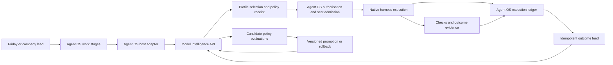

# Agent OS model intelligence and learning execution plan

Date: 2026-10-27  
Status: Proposed architecture and delivery plan; routing backend not implemented by this change.  
Related: [Agent OS operating model](2026-10-25-agentos-operating-model.md), [capability inventory](2026-10-25-agentos-capability-inventory.md), [Friday design blueprint](../../prototypes/agentos-designs/friday/design.html).

## Product decision

Build **Model Intelligence** as an independent product, with Agent OS as its first host integration. The name is provisional. It selects a qualified execution profile for a unit of work, explains the selection, measures the outcome, and learns which profiles perform best. It has its own API, versioned policies, evaluation history, storage migrations, SDK, and independently runnable distribution from the first implementation. Packaging it separately must not require extracting business logic from Paperclip later.

Agent OS remains the company operating system: Friday, CEOs, employees, projects, tasks, routines, artefacts, decisions, execution, permissions, and audit. The model product answers **which qualified model configuration should do this stage, and what evidence supports that choice?** A better router does not replace employee skills or business ownership.

This plan adds to the agreed operating model. Friday remains portfolio-wide; CEOs remain company-scoped. Shared employees retain private company assignments. CEOs can retire their own assignment without retiring the employee globally. Shared capability improvements remain versioned and optional for each company. Platform code changes through Friday still require the owner's instruction.

## What changes now

The HTML Agent Map preview receives semantic colour on a white canvas: teal Friday, blue companies/projects, violet employee assignments, amber pending tasks, cyan active tasks, green completed tasks, and terracotta evidence. A persistent legend, accessible labels, tooltips, and the selected task's written state supplement colour. Animated connections still represent sample tasks in progress. No extra decorative work nodes are introduced.

The prototype remains fictional data, separate from the production application. This colour change does not implement live execution or model learning. Only the text filename `IMG_6005.jpg` was available during planning; the suggested feature breakdown below is illustrative and is not attributed to that image.

## Current foundation and the gaps

| Existing owner | What it provides | Required extension |
| --- | --- | --- |
| `server/src/services/ai-connection-router.ts` and `packages/shared/src/ai-connection-router.ts` | Plugin selection among host-authorised account candidates, runtime compatibility checks, usage-aware selection, task pins, transaction revalidation, activity events | A versioned model-profile selection contract with work context, policy receipts, stage/attempt boundaries, and evaluation feedback |
| `server/src/services/ai-provider-routing.ts` | Projects a selected connection into the harness environment | Keep provider configuration here; it is not an outcome-learning router |
| `ai-connections.ts`, `ai-connection-runtime.ts`, `subscriptions.ts`, `subscription-report.ts`, `quota-windows.ts` | Grants, runtime authentication, subscription identity, reported usage and billing attribution | Qualify seat-wide capacity admission across companies; preserve shared-account identity and avoid double counting |
| `packages/adapters/codex-local/`, runner and adapter utilities | CLI/ACP execution, model settings, auth and runtime integration | Map supported capabilities into a provider-neutral profile and normalise observed model/attempt events |
| Native heartbeat/execution and budget services | Work execution, lifecycle, recovery, budget enforcement | Persist routing receipts before dispatch; add bounded stage handoffs without a second scheduler |
| Local run log, activity log, artefacts and work products | Execution evidence, change history, outputs | Correlate decisions, attempts, checks and learning provenance; add completeness and freshness indicators |

The existing pool schema prevents duplicate account connections and gives each member one model profile. The result selects a member, and the task pin retains that selection. It does **not** already implement choosing among multiple models on one seat or learning from verified outcomes. Creating duplicate account entries to imitate model choices would break the accounting model.

Extend the host contract to enumerate multiple qualified **profile options beneath one account**, with an opaque profile ID and a shared capacity identity. Preserve the existing round-robin/usage-aware contract for existing consumers. Add a versioned capability for model selection; old plugins continue unchanged. Host revalidation remains mandatory. The router never returns arbitrary environment variables, credentials, permissions, or executable configuration.

The older [smart model routing proposal](2026-04-06-smart-model-routing.md) concerns a cheap preflight before primary execution. This plan is a broader Agent OS extension, not evidence that the old proposal shipped. Keep its useful session-continuity constraints; do not silently replace established consumers.

## Independent product boundary

Proposed independently buildable units in the fork:

| Unit | Owns |
| --- | --- |
| `services/model-intelligence/` | HTTP API, policy and profile registry, ranking, experiment/evaluation jobs, independent database schema and migrations |
| `packages/model-intelligence-contracts/` | OpenAPI/JSON Schema, stable portable types; no Paperclip database, adapter, or SDK imports |
| `packages/model-intelligence-sdk/` | Typed client, idempotency, receipt validation, outcome delivery helpers |
| Agent OS integration in the existing connection-router/plugin boundary | Authorised profile discovery, translating work into requests, native execution linkage, outbox delivery, company-scoped UI projections |
| Optional reusable management UI | Policy/evaluation views backed only by the product API, embeddable in Agent OS and later runnable as its own console |

Ship a container/CLI distribution with health/readiness checks, configuration reference, migrations and upgrade instructions. Local development may run alongside Agent OS on the same machine, with its own process and storage credentials. It must start and pass contract tests without Paperclip. Include a tiny reference host that submits fixture work and outcomes; it does not need an Agent OS company database.

The product authenticates host installations and tenants. A company maps to an opaque scope; portfolio policies require explicit owner grants. The service trusts authenticated, validated host receipts, not caller-supplied company IDs. Isolation, rate limits, export/delete/retention, API versioning, backups, and migrations are product responsibilities from the first release.

Agent OS remains authoritative for execution and permissions. Model Intelligence owns its policy/evaluation records and selection receipts. The host stores an immutable copy or digest of the receipt with its execution record. Durable outbox delivery and idempotent ingestion connect these two histories; avoid a fragile cross-service dual write.

The product receives no model-account secrets. A future host can use its own execution adapters and accounts. Provider-specific protocol parsing stays in provider adapters, not in the learning algorithm. This makes the router usable as a separate product without requiring customers to adopt Paperclip.

## Subscription execution

Start by qualifying the user's existing Personal Pro account through the supported Codex connection. OpenAI documents ChatGPT sign-in for subscription access separately from API-key usage. Its authentication documentation also distinguishes enterprise automation tokens and programmatic API workflows. Therefore sign-in success alone does not prove the intended unattended production pipeline is supported. Verify the actual integration and account before admitting recurring work. [OpenAI authentication](https://learn.chatgpt.com/docs/auth)

The documented app-server interface exposes model/effort discovery, account rate-limit information, and execution events. The installed adapter may not expose all of them. Keep the current execution transport where it meets the contract; evaluate an app-server adapter only where it closes a demonstrated gap. [Codex app-server](https://learn.chatgpt.com/docs/app-server)

Discovery is not entitlement. OpenAI explicitly cautions that `model/list` can be a bundled catalog in its token-sharing configuration; completed inference verifies access for that request. Maintain separately: discovered, account-access verified, workflow-qualified, stale, unavailable. Do not introduce that authentication flow without establishing its eligibility and requirements. [Codex token-sharing integration](https://developers.openai.com/siwc/token-sharing-open-source/codex-app-server)

Qualification must prove authentication/funding mode, actual selectable models and efforts, required tools, event coverage, child-run visibility, restart/resume, interruption, quota waits and the intended automation mode. It must not scrape a chat UI, extract unsupported credentials, or assume unavailable enterprise hooks.

Use a policy of **subscription included only** by default. API billing, subscription overage, purchased credits and paid voice remain separate disabled routes unless specifically authorised. An absent API-key environment variable is not sufficient proof of funding. When funding or entitlement cannot be established, hold the request with a clear reason. If Personal Pro cannot support a required execution mode, discuss the concrete limitation before changing the product or billing arrangement.

Account capacity is shared across all profiles, employees and authorised companies on that seat. Extend native admission with atomic reservations, priority/fairness, a reserved interactive allowance for Friday, expiration/reconciliation and durable waiting. Multiple profiles do not manufacture more quota. The router recommends; the host acquires capacity and rechecks current grants before dispatch.

On a seat, optimise completion quality, elapsed time, retries and measured allowance consumption. Do not present API token prices as subscription savings. Keep actual external charges, subscription fee allocation, tokens and quota observations separate. Provider-wide quota deltas may include other activity and cannot automatically be attributed to one run. Missing or ambiguous usage remains unknown.

## Routing a request

1. **Define the work stage.** Friday or the responsible lead identifies the outcome, owner, dependencies, acceptance checks, risk, deadline and permitted actions. Existing or new projects use the same contract. Routine steps enter through the same path. Deterministic work that needs no model uses native tools directly.
2. **Build eligible profile options.** The host applies company grants, account funding, tools, context/modality limits, sandbox requirements, observation coverage, continuity and account qualification. Model Intelligence can reject options but cannot invent additional authority.
3. **Rank eligible options.** Choose the lowest expected resource use that meets the stage's quality and latency requirements. Consider model, reasoning effort, harness version, approved prompt version and context strategy together. High-risk or ambiguous work may start on a stronger profile immediately.
4. **Persist the decision.** Record the policy version, inputs/fingerprints, chosen profile, alternatives and reasons before native dispatch. Revalidate and acquire the seat reservation atomically at the host. A stale decision is rerouted with a new receipt.
5. **Execute and observe.** Use the native executor. Capture events, tools, child work, outputs, errors and provider-reported model changes. Mark gaps explicitly. A task's employee identity does not change just because its model profile changes.
6. **Verify the result.** Run independent acceptance checks. A completed provider turn is not a passed task. Separate objective checks, evaluator judgments, user acceptance and delayed production outcomes.
7. **Repair, escalate, wait or stop.** Classify failure before spending another attempt. Missing context may call for targeted retrieval; an access error needs a connection fix; insufficient capability may justify a stronger profile. Each transition has a receipt and a bounded budget.
8. **Learn from the outcome.** Record the complete trajectory, including failed attempts, and propose improvements for evaluation. Final success must not erase earlier failures or their resource use.

Use provisional capability tiers such as Efficient, General and Deep. Bind them to exact qualified model IDs and supported efforts per account; do not permanently associate an employee or workload with a provider's marketing name. OpenAI likewise recommends testing model and effort combinations against the actual workflow. [Model selection guidance](https://developers.openai.com/api/docs/guides/model-selection)

## A feature broken into work

Illustrative request: “Add team invitations to the customer portal.” This is not a reconstruction of the missing image.

| Stage | Work and likely starting profile | Evidence before proceeding |
| --- | --- | --- |
| Discover | Read existing auth, requirements and active changes; General | Linked sources, constraints and explicit acceptance criteria |
| Design | Resolve tenant isolation, permissions and expiry; Deep if ambiguous | Reviewed design and security scenarios |
| Implement bounded parts | Email template, form, known patterns; Efficient if qualified | Diff and focused checks |
| Implement sensitive parts | Authorisation and token handling; General/Deep | Negative tests, tenant-boundary checks and review |
| Verify | Run deterministic tests; independent model review where useful | Recorded test results and findings, not the author's confidence |
| Release | Existing deployment workflow under its approved mandate | Build/release receipts, health checks and rollback reference |
| Observe | Monitor failures and feedback using an owned routine | Production outcomes linked to this feature and its original attempts |

The lead creates the dependency graph, parallelises independent authorised stages, and preserves one owner per task. Model Intelligence chooses execution profiles within those stages. It neither hires employees nor becomes a competing project manager. Marketing, product analysis and support use the same mechanism with different success criteria and time horizons.

## What self-learning means

The first learning target is **the routing policy**, including which approved prompt and context strategy to use. Foundation-model training is outside the initial scope. Better employee methods are published through the separate capability library and can become input versions in evaluations.

Record outcomes by task family, complexity/risk, evidence completeness, profile version and company scope. Measure first-pass success, final accepted success, attempts, regressions, elapsed time, human rework and observed usage. Split provider transport retries, model turns, repair attempts and workflow retries; “three iterations” must have an unambiguous definition.

Start with transparent rules and a conservative baseline, then learn in this sequence:

1. Build representative benchmark tasks from authorised, sanitised examples. Include failures and difficult cases. Keep a held-out and time-separated test set. Preserve company data boundaries.
2. Compare candidate model/effort, prompt and context changes on equivalent tasks with the same acceptance checks. Use separate controlled variants to determine whether the gain came from better context, a better prompt, or a stronger model. An expensive-model success after a weak-model failure does not prove model choice caused the improvement.
3. Run offline candidate evaluations in sandboxes. Replays may read recorded evidence; they must not repeat real publishing, customer messaging or deployment. Count experiment usage in the same account budget.
4. Run routing in shadow mode. It records what it would select while the existing approved route executes. Shadow choices alone do not establish alternative-model quality; that needs controlled runs.
5. Promote to a small low-risk canary only after the agreed quality floor, non-regression checks and resource targets pass. Require enough independent cases and uncertainty reporting, not a single successful example.
6. Adopt a versioned policy within an approved mandate, monitor drift, and roll back if quality, resource use or coverage regresses. Companies can pin a policy or opt into an approved release channel. Global publication never silently updates every company.
7. After sufficient data, optionally introduce a constrained contextual bandit: choose among already qualified profiles, explore only within low-risk limits, record selection probabilities, and evaluate against a stable holdout. No uncontrolled online experiments on live high-impact actions.

Cold-start task families use the baseline until there is enough evidence. Treat pending, cancelled and unknown outcomes separately from success or failure; account for delayed outcomes and selection bias. Calibrate model judges against deterministic results and human assessments. Restrict policy promotion to trusted evaluators; task content and a model's self-rating cannot rewrite routing rules.

Optimise expected resources **per accepted result**, including retries, verification and review. Quality thresholds are hard constraints; resource savings are secondary. This system can improve measured reliability, but cannot guarantee a model works every time.

Cross-company learning shares evaluated methods and aggregate evidence under explicit policy, not private prompts, credentials, source files or transcripts. For a separately sold product, cross-customer learning is disabled unless each customer explicitly participates. Each company can adopt or decline shared improvements independently.

## Portable API and data contract

Proposed v1 endpoints, to be defined in OpenAPI before implementation:

| Endpoint | Purpose |
| --- | --- |
| `POST /v1/profile-observations` | Host reports a profile's capabilities, qualification, funding class and freshness; no secrets |
| `POST /v1/route` | Idempotent request with opaque tenant/scope/work/stage IDs, task features, constraints, authorised candidate IDs and policy version |
| `POST /v1/outcomes` | Idempotent, authenticated ordered receipts for execution and verification, including corrections and unknown states |
| `GET /v1/decisions/:id` | Explain a selection and its policy/evidence; scope checks apply |
| `GET /v1/policies` and `GET /v1/evaluations/:id` | Inspect policy history and benchmark results |
| `POST /v1/policies/:id/promote` and `POST /v1/policies/:id/rollback` | Version-checked changes by an authorised operator or approved release mandate |

`route` returns `selected`, `wait`, `unavailable`, or `needs_decision`, with receipt ID, policy version, explanation, expiry and any retry time. A selected result names a host-supplied profile and approved prompt/context versions. The host validates every selected field; selection is not execution permission.

Core records: ProfileObservation, RoutingPolicyVersion, RouteDecision, AttemptOutcome, EvaluationDatasetVersion, Experiment, EvaluationResult, Promotion, Adoption and Rollback. Use opaque references and content hashes; raw prompts and context remain in host-controlled protected artefacts unless an explicitly scoped evaluation needs them. Do not log credentials. Record retention/tombstones so deleted evidence is shown as unavailable rather than silently claimed to remain replayable.

## Full execution audit

Agent OS should answer: **who did what, for which company, using which actual model, why that profile was chosen, what changed between attempts, and what proved the result?**

| Evidence | Required fields |
| --- | --- |
| Ownership | Portfolio reference, company, project, task, employee, assignment, lead, parent/child work IDs |
| Selection | Request/stage/decision IDs, policy version, candidates, rejection reasons, selected profile, score/confidence, expiry and authority |
| Execution | Native run/session/turn/attempt IDs, requested model and effort, observed model and effort when available, harness version, account reference and funding classification |
| Inputs | Instruction/skill/prompt/context versions, protected artefact references, source provenance and retrieval changes |
| Activity | Exposed plan/analysis summaries, messages, tool calls/results, child delegations, workspace diffs and checkpoints |
| Outcome | Acceptance check versions/results, reviewer findings, human decisions, eventual production feedback and attribution uncertainty |
| Resources | Timestamps, waits, observed tokens/quota, actual charges where known, attribution confidence, retry/repair/escalation counts |
| Learning | Candidate origin, dataset and experiment versions, evaluation results, adoption scope, promotion and rollback history |

Keep the native local run log distinct from first-party telemetry and optional OpenTelemetry exports. Business audit and learning evidence must not require an external tracing service. See [run-log ownership](../run-log-events.md).

Capture the provider's exposed reasoning summaries and operational events; do not promise unavailable private model reasoning. Record requested versus provider-reported effective models and explicit observation gaps. If a harness hides delegated actions or changes needed for the promised audit, it is not qualified for that autonomous workflow until visibility is restored. A polished graph cannot substitute for missing evidence.

## Handoffs, failures and recovery

Model changes occur at an explicit stage boundary or a safe recorded checkpoint. Preserve existing task/session pins until the native owner validates a handoff. Do not resume another model on an incompatible hidden conversation state. Transfer only authorised context, artefacts and unresolved work, with a new attempt and its causal link.

Set limits per attempt, per stage and per workflow: elapsed time, model calls, repairs, escalations, tool actions and account usage. Initial low-risk policy can allow one context repair and one escalation; calibrate that default through evaluations. Repeated loops terminate as blocked/needs-decision with evidence. Infrastructure retry ownership stays with the harness and is counted separately.

External effects use idempotency keys and durable intent/result receipts where supported. Reconcile unknown deployments or publications before retrying. Do not claim exactly-once external effects where the provider cannot guarantee them. Repeating inference must not repeat an already-completed business action.

If the routing service is unavailable, preserve ongoing native executions and queue new routed work. A previously authorised, unexpired static fallback may be used only if configured and auditable. Never bypass grants, cross to an API key, or switch to an unqualified model to make the screen look active. Durable execution evidence can be delivered to the learning service later through the outbox; unknown coverage remains visible.

## Interface integration

Keep Friday as the main interface. “Why did this take three attempts?”, “Which tasks can use a lighter model?” and “Show me improvements waiting for adoption” open scoped canvas views.

Task detail gains an **Execution** timeline: stage, employee, model profile, attempts, changes, checks, resource use and final outcome. Workforce shows approved profiles and capability versions. Company decisions include policy changes outside the CEO's mandate. Advanced Model Intelligence views expose seat health, benchmark results, policy comparison and rollback without adding mandatory configuration steps to everyday work.

The Agent Map retains its semantic node colours. Add an optional model/attempt lens later, with a different explicit legend, observed model labels and links to execution records. Do not overload agent identity, task status and model choice into one ambiguous colour scheme. Zoom preserves company/project/task context; selected graph records and the execution timeline agree. Permission edges and observed reads remain distinct.

## Execution sequence and release gates

| Milestone | Deliverable | Gate before proceeding |
| --- | --- | --- |
| 1. Qualification and baseline | Inspect the installed connection/runner versions and intended Personal Pro mode; record capabilities and run a bounded representative task set | Confirm funding, supported automation, real model access, required visibility and restart/quota behaviour; discuss any concrete limit |
| 2. Independent product skeleton | Contracts, SDK, service, storage migrations, container/CLI, host authentication, reference host | Runs without Agent OS; tenant isolation and idempotency contract tests pass |
| 3. Native integration and receipts | Versioned model-profile options per account; stage selection; persisted receipts; native revalidation; outcomes outbox | Legacy router behaviour retained; no duplicate account capacity; safe pinned-session handling and no paid fallback |
| 4. Explainable routing in shadow | Baseline classifier, quality constraints, candidate ranking and decisions in Agent OS | Every suggestion explainable; actual route unchanged; latency and missing-data behaviour measured |
| 5. Bounded live routing | Qualified task families, atomic account admission, repair/escalation caps, execution timeline | Quality targets met; limits, revocation, failures, restart and unknown side effects proven |
| 6. Evidence-based learning | Dataset versions, controlled experiments, evaluation reports, canary policy release and rollback | Demonstrated improvement on held-out work; no hidden regression or cross-company context transfer |
| 7. Product packaging and operations | Standalone management UI if needed, install/upgrade/export docs, backup/restore, health dashboards, API compatibility suite | Reference host and Agent OS both work against the same distributable; no Paperclip runtime dependency |

This sequence fits alongside the existing Friday-shell integration plan. Connect real execution evidence before calling the visualisation live. Prove one supported harness first; add others only through the same capability and outcome contract. The architecture supports multiple providers without assuming that any named provider's subscription supports every use case.

## Acceptance scenarios

- One seat offers several model profiles; concurrent requests from two companies cannot double-spend the same capacity. Friday retains its reserved interactive priority and background work remains fair.
- The same employee performs work for two companies; prompts, retrieved context, credentials and evidence stay in the correct assignment. Approved shared methods can be adopted independently.
- An unauthorised/unknown model, stale capability, revoked grant, unavailable seat or unsupported tool is rejected before dispatch. No API or overage fallback occurs.
- A task succeeds after a context repair; the failed attempt, changed inputs, actual models, total resource use and successful checks all remain inspectable.
- A provider reports completion but tests fail; the task remains unsuccessful. Unknown/missing telemetry is not presented as zero usage or complete coverage.
- A stage escalates models after a checkpoint; session continuity, attribution, child events and prior effects remain correct. Unregistered opaque delegation fails qualification.
- Router outage, event replay, duplicate delivery, worker restart and quota reset recover without losing evidence or duplicating external actions.
- A new prompt or routing policy beats the baseline on a controlled dataset, enters a bounded canary and can be rolled back without changing another company's pinned version.
- Model or harness changes invalidate affected qualification and trigger re-evaluation. Pending or delayed production outcomes do not become fabricated success labels.
- The standalone service passes its reference-host suite with Agent OS absent. Product removal disables model-learning routes cleanly while established native non-router execution remains available under its existing policy.

## Execution assumptions

Start with the existing OpenAI subscription, subscription-only routing, visible qualified execution, and conservative rollout. No further business decision is required to complete this plan. Implementation should stop to discuss a demonstrated account/integration limitation or a required change to the agreed authority or billing model. The missing image can refine the feature-stage presentation when attached; it does not block the architecture.
