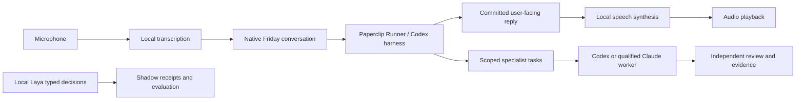

# AgentOS execution backlog — navigation, response and model intelligence

This continues the [landing and remaining-work checkpoint](2026-11-05-agentos-landing-and-remaining-work.md).
The owner requested a full backlog, implementation, focused practical checks and
questions only when needed. Source implementation, runtime activation, measured
results and manual acceptance are distinct states.

## Tasks and acceptance

| ID | Task | Acceptance | State / owner |
| --- | --- | --- | --- |
| N01 | Collapsible Departments and Projects navigation | Both top-level groups can open/close independently; departments progressively reveal their projects; compact rows; no permanently expanded project inventory. | Implemented; focused navigation check passed; browser acceptance pending |
| N02 | Stable sidebar on Audit Trail | Workforce, Saved Displays and Settings remain accessible on Audit Trail and long content pages; menu scroll does not displace the footer. | Implemented; viewport-bounded sidebar, independent scroll and nonshrinking footer; browser acceptance pending |
| D01 | Useful decision summaries | Title is followed by concise source-backed decision/context text; actual recommendation/summary wins over duplicate titles and generic feed copy. | Implemented; native resolver cache reused without extra requests; focused checks passed |
| D02 | Reversible decision expansion | A visible, accessible control expands and collapses details in place; native approval and required-input behavior is preserved. | Implemented; visible header disclosure, deep-link/refetch regression passed |
| V01 | Locate voice response delays | Inspect capture, endpoint detection, transcription, submission, runner reply and speech stages; measure real local speech where permitted; distinguish measured duration from full-turn unknowns. | Source path inspected; real synthetic synthesis measured; physical/LLM full-turn measurement remains open |
| V02 | Reduce avoidable speech delays | Remove proven waiting/serialization or first-use overhead without dropping speech, shortening useful answers, speaking internal reasoning or bypassing approvals. | Implemented; independent bounded workers and explicit speech warmup; eight worker checks and real synthesis check passed; backend activation pending |
| V03 | Expose response timing | Make directly observed stages inspectable without inventing reply correlation. | Implemented in Voice settings; final 55 relevant checks passed including active-conversation context; transcription/acknowledgment/playback measured separately; agent/total timing explicitly unknown |
| V04 | Native execution response timings | Audit queue delay and first exactly linked recorded agent comment, without claiming token/full-answer/audio timing. | Implemented; exact company/task/run/author linkage and timestamp bounds; six server and five UI checks passed; actual database/runtime acceptance pending |
| H01 | Inspect Friday's current harness | Report source/recorded installed harness and provider, separate from unverified current runtime configuration. | Assessed below: recorded Codex subscription/native Runner; current source supports Codex and qualified Claude paths |
| H02 | Choose the harness approach | Compare existing native Codex and Claude paths using primary documentation; retain one conversation owner, native authorization and subscription policy; identify any actual missing integration. | Assessed below: retain recorded Codex coordinator, separately delegate to qualified workers; no new provider/paid SDK path enabled |
| M01 | Task × actual-model comparison | Show observed task families, actual models, usage, latency and outcome evidence; unknown quality remains unknown. | Implemented; observed execution receipts grouped once per run/model; five server and five UI checks passed |
| M02 | Per-run model routing audit | Inspect selected route, actual usage, System One proposal/abstention, reasons and evidence through the existing administrator boundary; no raw prompt exposure. | Implemented; latest 50 runs, company-bound evidence and explicit bounds; focused checks passed |
| M03 | Make refinement evidence understandable | Distinguish System One versus LLM from Elephant versus Goldfish; explain what can support a future recommendation and why insufficient evidence cannot establish a best model. | Implemented; explanation and reviewed-outcome links; no unqualified automatic routing change |
| L01 | Correct landing hero | Large reactive sphere right, vertically centered text left, mobile stack. | Implemented — `584d0135c`; three focused checks and token gates pass |
| L02 | Real landing screenshots | Current workspace, Agent Map and Decisions screenshots beside feature copy, inspected before public inclusion. | Blocked — Browser/Chrome control tools absent; owner explicitly requested Chrome; no replacement mockups |
| A01 | Activate reviewed backend | Native graceful restart with process/database preflight; verify no lost runs and loaded configuration. | Blocked — session denies macOS process inspection; prepared operator helper remains required |
| A02 | Focused integration and final user retest | Relevant component/service checks, affected semantics/build, token gates; then user confirms real browser and audio behavior. | Final integrated UI/server semantics, production UI build, token gates and maps pass; runtime/browser/audio acceptance remains |
| B01 | Preserve the wider backlog | Keep delegated-work/EGM proof, portfolio authority/capability adoption, seat-wide scheduling, knowledge/components, real business workflows and deferred cloud/Higgsfield stages visible. | Tracked in the linked remaining-work checkpoint; not erased by this batch |

## Execution order and boundaries

1. Navigation, decisions and model reporting run in parallel in their owning
   modules. The primary agent owns voice measurements, harness assessment and
   this ledger. All use existing authorized services and receipts.
2. Resolve root causes and make changes, then run the smallest relevant checks.
   Record earlier failed attempts and what changed on retry.
3. Integrate the independent changes; inspect shared contracts and relevant
   states, then perform affected build/type/token checks. No broad test campaign
   substitutes for the owner's requested practical acceptance.
4. Commit/push reviewable source changes. Activate through the supported native
   lifecycle when its external prerequisite is available; never mark source
   delivery as loaded-backend acceptance.
5. Close each row with evidence or an explicit remaining dependency. The landing
   screenshots and physical voice test stay open until actually performed.

“GEM” in the latest message is interpreted as the previously clarified
Jev/System One lane, now implemented with local open-source Laya. This is not
assumed to mean Google's Gemini model family. No paid API fallback is authorized
by this interpretation.

## Findings and evidence

- Navigation inspection: both child trees were always rendered; project rows
  lacked the same compact styles as department rows. Sidebar height followed
  long content, displacing the bottom links on Audit Trail.
- Decision inspection: disclosure handlers existed but collapse was at the
  bottom of details; generic feed descriptions and title-first selection hid
  useful recommendation/plan summaries.
- Model reporting inspection: billing and selection/shadow totals existed but
  lacked a joined task-family/actual-model view and per-run routing audit.
- Local health remains healthy. The supervisor's recorded last restart is
  3 November; Git HEAD in public health alone does not establish loaded code.
- Voice and harness inspection/measurement is ongoing; no millisecond full-answer
  promise or completed physical-audio acceptance is claimed.

## Friday harness assessment

The recorded installed setup already assigns Friday to a Codex subscription
through the native Paperclip Runner. This is installation evidence from
`2026-10-25-agentos-platform.md`, not a fresh authenticated read of the running
agent's configuration. The current source implements Codex app-server in
`packages/paperclip-runner/src/drivers/codex/`, including thread start/resume,
streamed events, interrupt and native tool/approval handling. The ACPX backend
also includes a qualified Claude profile; listing that profile does not establish
the user's current Claude account access.

The recommended implementation uses the existing durable Friday conversation
and runner as the coordinator. Keep Codex as its currently recorded harness.
Delegate substantive tasks to separately scoped Codex or Claude workers when
the selected account/profile is qualified, and use a separate review execution
for Goldfish. A second simultaneous harness does not automatically reduce
response latency or establish independent review. Switching providers inside a
live conversation must preserve native session, approval and receipt ownership.



The provider documentation supports these integration surfaces:

- [Codex app-server](https://learn.chatgpt.com/docs/app-server) exposes persistent
  threads, streamed events and interruption. The repository already uses this
  integration; no replacement conversation engine is needed for that capability.
- [Claude Agent SDK](https://code.claude.com/docs/en/agent-sdk/overview) embeds
  Claude Code's tool loop and session features. Its documented authentication
  conditions mean we must not silently introduce an API-billed SDK path or
  assume that a consumer login can be repackaged as third-party product access.
- [Claude streaming](https://code.claude.com/docs/en/agent-sdk/streaming-output)
  supports incremental events. Streaming a provider event is distinct from
  publishing a committed user-facing answer; internal reasoning/tool text must
  not become spoken output.

This is an integration recommendation based on source inspection and official
documentation, not a measured claim that one provider is faster. Use recorded
task/model outcomes and account qualification to decide future worker selection.
Laya performs bounded typed decisions; it does not replace the language model
that explains answers to the user.

## Voice measurements and change boundary

The old Python worker handles transcription and synthesis sequentially on one
stdin stream. A pending transcription therefore blocks audio generation even
though these are different operations. The fix separates two bounded on-demand
workers, with independent queue/deadline/failure/idle cleanup. This removes that
specific serialization; it does not reduce the language model's thinking time.
Two isolated interpreter processes have more process overhead, while model
weights remain separated by operation and are released after the idle deadline.

A real local synthetic Kokoro test measured 2,133 ms cold, then 313/310 ms warm
for a short sentence (`/private/tmp/agentos-voice-baseline-20261105.log`). No
microphone input or provider inference was involved. The combined prepare test
failed on Whisper import because this session cannot access a Metal device;
that is a sandbox/GPU limitation, not a demonstrated missing dependency or
successful transcription test. Its following speech calls still worked.
Evidence: `/private/tmp/agentos-voice-prepared-baseline-20261105.log`.

Client measurements cover only directly observed transcription, submission
acknowledgment and audio-start delays. Existing voice bindings lack reliable
request/run correlation, particularly across typed or overlapping turns, so
agent-response and end-to-end latency must remain unknown until a correlated
native receipt is available. Do not infer those durations from the next reply.

The split worker's first benchmark found prepare at 674 ms but first synthesis
still at 1,253 ms (next synthesis 333 ms). Explicit speech preparation now also
synthesizes and discards a short synthetic phrase once per cold worker. The
repeat measured prepare at 1,757 ms, then synthesis at 313/307 ms. This moves
first-inference work into the existing preparation stage; it does not eliminate
cold startup or promise that every reply arrives in that time. Both logs are
retained: `/private/tmp/agentos-voice-split-20261105.log` and
`/private/tmp/agentos-voice-primed-20261105.log`.

## Verification record

- Navigation: focused component check, token gates, map structure and whitespace
  passed. Evidence: `/private/tmp/agentos-navigation-followup-tests-20261105.log`.
- Decisions: 121 relevant row/card/resolver/attention checks passed. Evidence:
  `/private/tmp/agentos-decisions-followup-tests-20261105.log`.
- Voice worker: eight checks passed for simultaneous independent operations,
  bounded admission, EPIPE/failure isolation, late-child events, deadlines, idle
  release and exit cleanup. Python syntax passed. Evidence:
  `/private/tmp/agentos-voice-workers-tests-final-20261105.log`.
- Voice timing: 43 relevant checks passed, including monotonic measured stages
  and stale/cancelled callback isolation. Evidence:
  `/private/tmp/agentos-voice-timing-tests-20261105.log`.
- Initial model audit: five server and five UI checks, shared build, server/UI
  semantics, token gates and maps passed. Evidence prefix:
  `/private/tmp/agentos-model-audit-*-20261105.log`. The initial map check rejected
  an overbroad review label; the corrected baseline annotation passes in `maps-r2`.
- Native response-timing addition: six server and five UI checks and shared
  build passed. Evidence: `/private/tmp/agentos-model-audit-timing-{server,ui,shared}-20261105.log`.
  Queue duration uses run creation/start; first-comment duration requires a
  directly attributed ordinary, undeleted agent comment on the same task/run.
  It may measure progress or an answer, not provider first-token or audible time.
- First integrated UI/server semantic checks and production UI build passed:
  `/private/tmp/agentos-followup-{ui-tsc,server-tsc,ui-build}-20261105.log`.
  The build retains existing chunk-size and mixed MarkdownEditor import warnings.
- Final integration after native timing and active-voice-context fixes passed:
  UI/server semantics, production UI build and maps (37 areas, 200 capability IDs).
  Evidence: `/private/tmp/agentos-followup-final-{ui-tsc,server-tsc,ui-build,maps}-20261105.log`.
  The final build retains the same existing warnings.
- Browser/audio acceptance and actual database projection execution are not
  claimed. Browser/Chrome controls are absent; local Whisper import is blocked
  by unavailable Metal GPU access; backend process preflight remains unavailable.

Integration review also found that company Settings can show a business company
while Friday's conversation remains in its authorized platform home. Voice timing
must receive that explicit active conversation context rather than using the
display-company filter; the company settings and API scopes remain unchanged.
This correction is implemented. A full component-chain check proves timing from
platform Friday appears in business Settings while the settings API retains its
business company scope. Mismatched or fully unbound conversation measurements
are hidden. All 55 relevant checks pass at
`/private/tmp/agentos-voice-timing-context-tests-20261105.log`; final token gates
pass at `/private/tmp/agentos-voice-timing-context-token-gates-20261105.log`.

## Activation and practical acceptance

The initial activation is still external to this session because macOS process
inspection is denied. The prepared helper performs native preflight and a
graceful restart; run from ordinary Terminal:

```sh
python3 /Users/dave/cursor-tutor-1/AgentOS/paperclip/scripts/restart-agentos-local.py
```

Then use these short checks; no deep test campaign is required:

1. Open `/welcome`: desktop text left/sphere right, smaller screens stacked.
   The requested current screenshots remain a separate unfinished deliverable.
2. In a company, open/close Departments, a department branch and Projects.
   Select a project, then Audit Trail; Workforce, Saved Displays and Settings
   should remain accessible in the bottom navigation.
3. Open Decisions: read the title and summary, expand, collapse, and inspect
   full details without being forced to resolve the decision.
4. Speak one short question to Friday, then one longer request. Check response
   completeness and interruption, and inspect Voice response timing in Settings.
   Record actual perceived delay; the synthetic speech result is not a substitute.
5. In Administration → Model Intelligence, filter task/model groups, open a
   routing audit row and its native execution link, and check queue/comment
   timing, selected versus executed model, shadow reasoning and review evidence.
   Empty/unknown evidence is expected when no qualifying record exists.
6. Retest Performance and loop save/reopen from the earlier fix batch. Its exact
   reported Performance exception and real audio experience remain unproven.

The full older business/platform backlog remains linked above. This batch does
not certify delegated business outcomes, Goldfish isolation, model quality,
shared-seat scheduling, cloud deployment or current dashboard screenshots.
